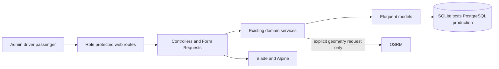

# Requirements

### Goal and verified status
Plan the completion of every open requirement in the supplied backlog, excluding HU-003 and deferring messaging (RF-21/HU-20) as requested. JWT/token login will not be added; Laravel Breeze session authentication remains the contract.

The backlog is **not complete**: `docs/requirements-status.md` currently records only RNF-05 as partial, and its own introduction says requirements absent from that table are not verified or complete. `docs/requirements-deviations.md` already records the HU-003 JWT exclusion. The prior 232-test suite pass validates the then-current code, not the unverified backlog items.

### Scope
- Finish Route & Stop Studio behavior and close the remaining bounded-data gap in legacy route forms.
- Complete trip lifecycle, authorization, location freshness/accuracy, ETA and passenger discovery behavior.
- Complete emergency/incident reporting, favorites, account onboarding/verification, driver approval and admin account workflows.
- Complete maintainability/accessibility work plus documented local performance, browser and backup/restore evidence.
- Record each completed requirement with traceability test names, docs, and changelog/status updates. Existing safe stop deletion and delivered Route Studio work are to be characterized and retained, not rebuilt.

### Explicit exclusions and gates
- HU-003: excluded; retain session auth and the existing documented deviation.
- RF-21/HU-20 messaging: deferred by user; do not build messaging UI or workflow in this plan.
- Production deployment wiring remains out of scope; local backup/restore procedures are in scope.
- Any schema migration is a stop-and-seek-owner-approval gate and must work on SQLite tests and PostgreSQL production.
- Do not invent acceptance criteria for referenced but undescribed HU-017/HU-018 community features. HU-034 community widgets depend on retrieving/reconciling those stories; implement the defined average-rating metric independently.

### Defaults from the backlog
Use its recommended defaults unless the owner later directs otherwise: one-login profile entry points without role elevation; passenger verification only; keep HU-024’s current required 1000-character description and document the deviation; in-app notifications only; UI-chrome-only localization; confirm-and-end an active driver trip at logout; no 2FA; and document any missing performance threshold rather than fabricating one.

# Technical Design

### Current implementation
- The app is a Laravel MVC monolith using role middleware and Blade/Alpine. `routes/web.php` contains the `auth` + `admin` group, driver/passenger groups, and an auth-only `/api` group; the latter needs explicit role decisions/tests under RNF-02.
- The Route Studio already has `Admin\RouteManagementController`, `Admin\StopController`, `RouteStopSyncService`, `RouteGeometryService`, `resources/js/route-studio.js`, and bounded stop-data tests. `docs/requirements-status.md` still marks RNF-05 partial because legacy route forms load the full catalog.
- `DriverController::startTrip()` selects `drivingBus` and its first route; `endTrip()` stores occupancy/end/status but not distance/path. `Trip` already exposes `distance_km` and `path_taken` fillable/casts, so inspect actual migration columns before proposing any schema change. `TripLifecycleTest` is the nearby feature-test pattern.
- `EmergencyReport` already has bus and coordinate fields; driver submission is in `DriverController`, admin handling is in `AdminController`, and passenger incident submission/admin workflow are in `IncidentController` and `Admin\IncidentManagementController`.
- `User` has session-auth, role, location, message, ratings and favorites relationships. The message model/table exist, but messaging is deferred by instruction.

### Proposed implementation
Follow existing controller/Form Request/Blade conventions, keep admin JSON under `/admin`, and keep all writes CSRF-protected and validated server-side. Reuse the route synchronization and geometry services; route geometry remains explicit-action-only and retains stored geometry on OSRM failure. Add characterization tests before changing established behavior, then implement failing acceptance tests, make the smallest passing changes, and refactor with the suite green.

For data integrity, first characterize actual schema/data and current safe-delete behavior. Propose only necessary migrations and pause for approval before applying them. Preserve trip/report/rating history by deactivation or guarded deletion. Use existing session authentication; never introduce JWT, Sanctum tokens, or a token login flow.

### File Structure
- Existing application files to extend: `app/Http/Controllers/{Admin,Driver,Passenger}`, `app/Http/Requests/Admin`, `app/Models/{Trip,Bus,User,EmergencyReport}`, `app/Services/{RouteStopSyncService,RouteGeometryService}`, `routes/web.php`, Route Studio Blade/JS, and the relevant existing feature tests.
- Add focused feature tests under the corresponding `tests/Feature/{Admin,Driver,Passenger,...}` areas; add service/command tests only where behavior belongs there.
- Update `docs/requirements-status.md`, `docs/requirements-deviations.md`, relevant domain docs, `docs/performance.md`, `docs/browser-compat.md`, `docs/accessibility.md`, `docs/runbooks/backup-restore.md`, and `docs/_devlog.md` as each item is verified.

### Architecture Diagram

# Testing

### Validation approach
- For each requirement, verify the cited source and add a characterization test before behavior changes; then demonstrate acceptance tests fail for the intended reason before production code is changed.
- Cover authorization with guest, wrong-role, and correct-role cases for every new or changed endpoint; include privacy assertions for public/shared payloads.
- Run focused tests during each feature slice and the full `php artisan test` suite before and after the integrated work. Run Pint on touched PHP files and the Vite build when frontend assets change.
- Exercise migrations against the SQLite in-memory test configuration and ensure syntax/behavior remain PostgreSQL-compatible. Do not claim browser, load, or restore evidence without executing those checks and recording environment, versions, dates, and results.

### Key scenarios
- Trip start defaults remain backward compatible; selected bus/route combinations persist; invalid associations and busy bus/driver states are rejected. Trip completion handles recorded positions, absent positions, occupancy, and distance/path storage.
- Role matrix protects `/api` and new routes; rating requires a completed trip with that driver; bus assignment rejects non-drivers.
- ETA distinguishes fresh, stale, and unavailable service; stale/no-bus responses and UI are explicitly approximate. Location accuracy is optional, validated, stored, and serialized without breaking old clients.
- Report validation, rate limiting, admin ordering/status changes, favorites limit/order, and public identity privacy are covered.
- Pending/rejected/approved driver flows, verification/resend throttling, password-change/reset flows, settings and active-trip logout behavior are tested.
- Characterize deactivation/history guarantees and Route Studio ordering, geometry failure preservation, and catalog caps.

### Evidence and traceability
Run the named browser scripts and k6/load script only against the documented target profile, then record browser/viewport outcomes and latency/throughput/error summaries. Add a backup command/retention/restore test in the local environment and document exact restore steps. Add automated markup assertions plus a manual keyboard/contrast checklist for accessibility. Do not mark an item complete until its test/evidence and status/docs entry exist.

# Delivery Steps

### ✓ Step 1: Finish Route Studio and close stop-catalog performance gaps
The Route Studio supports the specified route/stop editing flow without loading the complete stop catalog on any route-management page.
- Characterize existing Route Studio and legacy route-form behavior in the current `RouteStudioManagementTest` and `RouteCrudCharacterizationTest` patterns.
- Complete HU-045/HU-046 interactions using `RouteStopSyncService` and `RouteGeometryService`: combined ordering, anchored frequent-stop handling/review indication, explicit geometry generation, unsaved-state protection, and failure preservation.
- Replace unbounded stop loading in legacy create/edit flows or retire those forms deliberately; retain a bounded searchable/paginated path and verify no OSRM request occurs on page load.
- Add/update RNF-05 tests for result caps, search/page behavior, and query behavior; document the remaining boundary and traceability.

### ✓ Step 2: Preserve history and enforce referential integrity
Route, bus, and driver lifecycle operations no longer destroy records that have trip or other history.
- Characterize current route guards in `RouteController` tests and existing stop safe-delete tests before changing any policy.
- Verify duplicates in `route_stop` and actual foreign keys/deletion references; only then propose necessary migration(s), including the requested unique route-stop index.
- After explicit owner approval, add SQLite/PostgreSQL-compatible constraints or soft-delete/deactivation fields only where required.
- Extend guards and tests for HU-038/HU-043/HU-047 and RNF-12; verify historical trips, ratings, favorites and reporting views remain available.

### * Step 3: Complete trip lifecycle and server-side authorization
Drivers can select valid assigned/available trip resources, completed trips record their measured data, and role access matches the endpoint matrix.
- Extend `DriverController::startTrip()` and `TripLifecycleTest` for optional bus/route selection, backward-compatible defaults, route-to-bus linkage, active-trip conflicts, and authorization.
- Characterize the real trip-position source and schema, then add RF-12 tests for Haversine distance/path capture and empty-position behavior; reuse a project helper if one exists and avoid adding columns unless verified necessary and approved.
- Add RNF-02 role-matrix coverage for every `/api` endpoint in `routes/web.php`; require a completed trip for driver ratings and validate driver role on bus assignment.
- Update the related driver, rating, and authorization documentation/status entries and preserve existing trip validation.

###   Step 4: Finish passenger map freshness, ETA, and discovery contracts
Passenger map payloads and UI expose fresh, privacy-safe location and ETA information without misleading precision.
- Add optional validated bus-position accuracy and payload coverage for RNF-08, gated on an approved nullable-column migration if the current schema lacks it.
- Implement the shared five-minute freshness rule for HU-014 and master-list HU-030 ETA; update passenger map/query and view paths for HU-009, including stale/no-serving-bus uncertainty notices.
- Complete HU-012 with aggregate-only live-location-share counts and in-app notify subscriptions if approved; exclude expired/revoked shares and enforce per-user ownership.
- Add RF-30/HU-009 endpoint and view tests, privacy assertions, and docs for freshness, ETA assumptions, client limitations, and subscription payloads.

###   Step 5: Complete emergency, incident, favorites, and dashboard metrics
Passenger and driver reports, favorites, and defined admin metrics meet their documented validation and privacy contracts.
- Extend existing `EmergencyReport`, `DriverController`, `AdminController`, `IncidentController`, and `IncidentManagementController` flows for passenger emergencies and optional incident route/bus/coordinates/public visibility, reusing existing fields where possible.
- Add validation, throttling, admin ordering/status resolution, and public reporter-identity exclusion tests for RF-19/HU-025; retain HU-024’s current required 1000-character description and document that deviation.
- Enforce HU-027’s five-favorite limit, ordering, optional labels, and per-user isolation with an approved migration only if required.
- Add HU-034 average-rating metric and empty-state tests; keep community activity blocked until the referenced HU-017/HU-018 acceptance criteria are available.

###   Step 6: Complete account onboarding and administration workflows
Account entry, passenger verification, driver approval, admin password lifecycle, settings, and safe logout follow the chosen session-auth defaults.
- Add HU-001 role-hint entry points without changing server-enforced roles; implement passenger-only HU-002 verification and resend throttling while preserving verified test factories.
- Implement HU-005/HU-006 pending driver signup and approval, private license-photo storage, validation, and blocked pending/rejected access; gate required schema changes on owner approval.
- Extend admin user flows for HU-041/HU-042 temporary invitation or reset handling without exposing passwords, enforce first-login password change as specified, and safely handle active trips on deactivation.
- Implement HU-030 settings using UI-chrome-only locale scope and in-app preferences, plus HU-031 logout confirmation/active-trip handling; test Breeze redirects, session invalidation, and role boundaries. Record HU-007’s no-2FA deviation.

###   Step 7: Close maintainability, accessibility, and operational evidence
Remaining quality requirements have verified tests, measured results, and reproducible local operational documentation.
- Refactor duplicated validation into Form Requests first, then move targeted inline JS into Vite modules; archive/remove obsolete seeders only after inventory and green characterization tests (RNF-11).
- Audit responsive/dark-mode views, keyboard/focus behavior, labels, icon controls and contrast; fix findings and record RNF-15/HU-033 evidence for 375px and 1366px.
- Execute the existing k6 and browser automation against recorded environments; document measured RNF-06 latency and RNF-14 load results, and resolve or explicitly report the missing threshold/browser-list questions without inventing values.
- Implement/test local RNF-13 backup creation, retention and restore procedure; document exact commands and limitations, keeping production deployment wiring out of scope.
- Add status rows and test/evidence references for each completed item, update domain docs and changelog, and reconcile the HU-017/HU-018 dependency before claiming HU-034 community metrics complete.