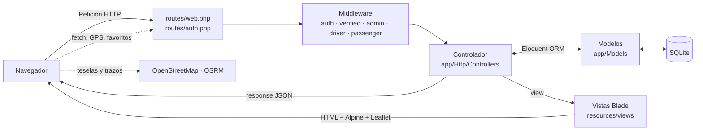
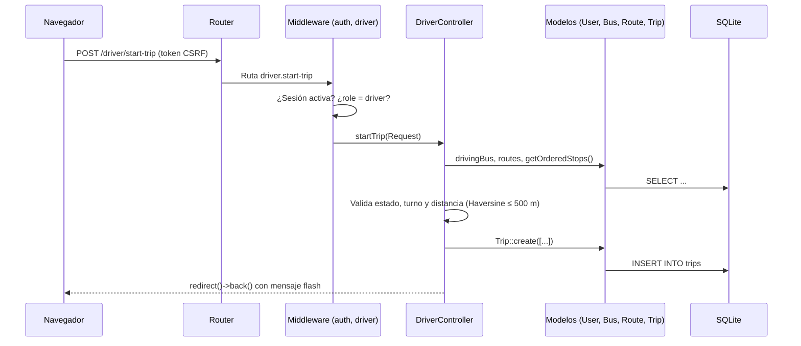

# Arquitectura

Ubicaditos sigue el patrón **MVC (Modelo–Vista–Controlador)** que propone Laravel. Cada petición HTTP entra por un único punto, se enruta hacia un controlador protegido por middleware según el rol del usuario, el controlador consulta los modelos Eloquent y devuelve una vista Blade (o una respuesta JSON en el caso de los endpoints de datos en tiempo real).

## Patrón MVC



| Capa | Ubicación | Responsabilidad |
|------|-----------|-----------------|
| **Modelo** | `app/Models` | Representa las tablas de la base de datos, define atributos asignables, conversiones de tipos (`casts`), relaciones y métodos de dominio como `Bus::updateLocation()` o `EmergencyReport::markAsResolved()`. |
| **Vista** | `resources/views` | Plantillas Blade que generan el HTML. Incluyen layouts, componentes reutilizables y scripts de Leaflet, Chart.js y Alpine.js. |
| **Controlador** | `app/Http/Controllers` | Recibe la petición, valida la entrada, aplica reglas de negocio, consulta los modelos y decide la respuesta (vista, redirección o JSON). |

Elementos de apoyo al patrón:

| Elemento | Ubicación | Responsabilidad |
|----------|-----------|-----------------|
| Rutas | `routes/web.php`, `routes/auth.php` | Mapean URL y verbo HTTP a un método de controlador. |
| Middleware | `app/Http/Middleware` | Control de acceso por rol. |
| Form Requests | `app/Http/Requests` | Validación encapsulada (login y perfil). |
| Exportadores | `app/Exports` | Construyen el conjunto de datos de los reportes CSV. |
| Comandos | `app/Console/Commands` | Tareas de consola: simulación y generación de trazos. |
| Componentes de vista | `app/View/Components` | Clases de los layouts `AppLayout` y `GuestLayout`. |

## Ciclo de vida de una petición

Ejemplo: un conductor pulsa **Iniciar viaje**.



1. `public/index.php` arranca la aplicación configurada en `bootstrap/app.php`.
2. El router resuelve la ruta y aplica su pila de middleware.
3. El controlador recibe la petición con **route model binding** (por ejemplo, `Bus $bus` se resuelve automáticamente desde `{bus}`).
4. Los modelos Eloquent ejecutan las consultas.
5. El controlador devuelve una vista con `compact(...)`, una redirección con mensaje flash (`with('success', ...)`) o un `response()->json(...)`.

## Estructura de carpetas

```text
ubicaditos-web/
├── app/
│   ├── Console/Commands/        # GenerateRoutePaths, SimulateBusMovement
│   ├── Exports/                 # ReportsExport (datos para CSV)
│   ├── Http/
│   │   ├── Controllers/
│   │   │   ├── Admin/           # AdminController, BusController, RouteController,
│   │   │   │                    # StopController, UserController, ReportController
│   │   │   ├── Auth/            # Controladores de Breeze (login, registro, contraseñas)
│   │   │   ├── Driver/          # DriverController
│   │   │   ├── Passenger/       # PassengerController
│   │   │   ├── DashboardController.php
│   │   │   └── ProfileController.php
│   │   ├── Middleware/          # AdminMiddleware, DriverMiddleware, PassengerMiddleware
│   │   └── Requests/            # LoginRequest, ProfileUpdateRequest
│   ├── Models/                  # User, Bus, Route, Stop, Trip, Rating,
│   │                            # FavoriteStop, Message, EmergencyReport
│   ├── Providers/               # AppServiceProvider
│   └── View/Components/         # AppLayout, GuestLayout
├── bootstrap/app.php            # Configuración de rutas, middleware y excepciones
├── config/                      # Configuración de Laravel
├── database/
│   ├── database.sqlite          # Base de datos local (ignorada por git)
│   ├── factories/               # UserFactory
│   ├── migrations/              # Esquema de la base de datos
│   └── seeders/                 # Datos de prueba de Oaxaca
├── lang/es.json                 # Traducciones al español
├── public/                      # Punto de entrada, imágenes SVG y assets compilados
├── resources/
│   ├── css/app.css              # Directivas de Tailwind
│   ├── js/                      # app.js (Alpine) y bootstrap.js (Axios)
│   └── views/                   # Vistas Blade por rol
├── routes/
│   ├── web.php                  # Rutas de la aplicación
│   ├── auth.php                 # Rutas de autenticación
│   └── console.php              # Comandos de consola por closure
├── tests/                       # Pruebas Feature y Unit
├── tailwind.config.js
└── vite.config.js
```

## Organización por roles

El sistema tiene tres roles almacenados en la columna `users.role` (`admin`, `driver`, `passenger`). La separación por rol se refleja en las tres capas:

| Rol | Prefijo de URL | Nombre de rutas | Middleware | Controladores | Vistas |
|-----|----------------|-----------------|------------|---------------|--------|
| Administrador | `/admin` | `admin.*` | `auth`, `admin` | `Admin\*` | `resources/views/admin` |
| Conductor | `/driver` | `driver.*` | `auth`, `driver` | `Driver\DriverController` | `resources/views/driver` |
| Pasajero | `/passenger` | `passenger.*` | `auth`, `passenger` | `Passenger\PassengerController` | `resources/views/passenger` |

### Middleware de rol

Los alias se registran en `bootstrap/app.php`:

```php
$middleware->alias([
    'admin'     => \App\Http\Middleware\AdminMiddleware::class,
    'driver'    => \App\Http\Middleware\DriverMiddleware::class,
    'passenger' => \App\Http\Middleware\PassengerMiddleware::class,
]);
```

Cada middleware comprueba que exista una sesión y que el usuario tenga el rol correspondiente mediante los métodos `isAdmin()`, `isDriver()` o `isPassenger()` del modelo `User`. Si no se cumple, responde con **HTTP 403** y el mensaje *"No tienes permiso para acceder a esta sección."*

### Redirección según rol

Tras iniciar sesión, la ruta `/dashboard` (`DashboardController@index`) redirige al panel correspondiente:

```php
return match ($user->role) {
    'admin'     => redirect()->route('admin.dashboard'),
    'driver'    => redirect()->route('driver.dashboard'),
    'passenger' => redirect()->route('passenger.dashboard'),
    default     => abort(403),
};
```

La raíz `/` redirige siempre a `/login`.

## Autenticación

La autenticación proviene de **Laravel Breeze** (sesiones con cookies y protección CSRF), adaptada al proyecto:

- El **registro público** crea siempre usuarios con rol `passenger`, exige nombre, apellido paterno, apellido materno, teléfono de 10 dígitos y una contraseña con letras, números y caracteres especiales. Tras registrarse, el usuario es dirigido a `passenger.menu`.
- El formulario de registro verifica en vivo si el correo ya existe mediante `POST /check-email`.
- Los **conductores y administradores** solo pueden ser creados por un administrador desde `/admin/users/create`.
- El inicio de sesión aplica limitación de intentos (5 intentos por correo + IP) en `LoginRequest`.
- La recuperación de contraseña y la verificación de correo funcionan con el mailer configurado (por defecto, `log`).

## Datos en tiempo real

El proyecto no utiliza WebSockets ni broadcasting. El "tiempo real" se logra con tres mecanismos:

1. **Envío de GPS del conductor:** la vista `driver/map` usa `navigator.geolocation.watchPosition()` y envía cada nueva posición con `fetch` a `POST /driver/update-location`, que actualiza `buses.current_latitude/longitude`.
2. **Endpoints JSON de consulta:** `GET /api/buses/active`, `/api/buses/{bus}/location` y `/api/routes/{route}/buses` devuelven el estado actual de los autobuses para cualquier usuario autenticado.
3. **Simulación en el cliente:** los mapas de pasajero y administrador animan los autobuses activos a lo largo del trazo OSRM de su ruta mediante `setInterval`, para dar una visualización fluida aun sin conductores reales conectados. Del lado del servidor, `php artisan buses:simulate` mueve los autobuses en la base de datos.
