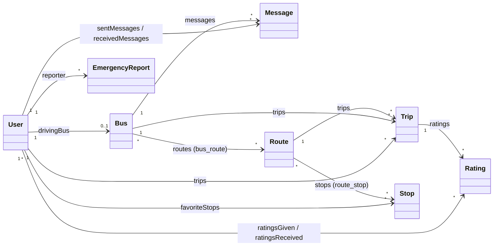

# Modelos

Los modelos viven en `app/Models` y extienden `Illuminate\Database\Eloquent\Model` (salvo `User`, que extiende `Authenticatable`). Cada modelo declara sus atributos asignables en masa (`$fillable`), las conversiones de tipo (`casts()`), sus relaciones y, en varios casos, métodos de dominio.

## Mapa de relaciones

## Resumen

| Modelo | Tabla | Descripción |
|--------|-------|-------------|
| `User` | `users` | Usuario del sistema con rol de administrador, conductor o pasajero. |
| `Bus` | `buses` | Autobús de la flota con ubicación GPS actual y conductor asignado. |
| `Route` | `routes` | Ruta de transporte con color, duración estimada y trazo geográfico. |
| `Stop` | `stops` | Parada física con coordenadas. |
| `Trip` | `trips` | Viaje realizado por un conductor en un autobús sobre una ruta. |
| `Rating` | `ratings` | Calificación (1–5) de un pasajero a un conductor. |
| `FavoriteStop` | `favorite_stops` | Parada marcada como favorita por un usuario. |
| `EmergencyReport` | `emergency_reports` | Reporte de emergencia generado por un conductor. |
| `Message` | `messages` | Mensaje entre usuarios asociado opcionalmente a un autobús. |

## User

`App\Models\User` — usa los traits `HasFactory` y `Notifiable`.

### Atributos

| Atributo | Tipo / cast | Descripción |
|----------|-------------|-------------|
| `first_name` | string | Nombre. |
| `last_name` | string | Apellido paterno. |
| `maternal_last_name` | string, nullable | Apellido materno. |
| `email` | string, único | Correo de acceso. |
| `password` | `hashed` | Contraseña (oculta en serialización). |
| `role` | enum | `admin`, `driver` o `passenger` (por defecto `passenger`). |
| `work_shift` | enum, nullable | Turno del conductor: `morning` o `afternoon`. |
| `phone` | string | Teléfono a 10 dígitos. |
| `avatar` | string, nullable | Ruta de imagen de perfil (no se usa en las vistas actuales). |
| `is_active` | boolean | Indica si el usuario está habilitado. Un conductor inactivo no puede iniciar viajes. |
| `current_latitude`, `current_longitude` | `decimal:7` | Última ubicación conocida del usuario. |
| `last_location_update` | datetime | Fecha de la última ubicación. |
| `email_verified_at` | datetime | Fecha de verificación de correo. |

Atributos ocultos: `password`, `remember_token`.

### Relaciones

| Método | Tipo | Modelo | Clave | Descripción |
|--------|------|--------|-------|-------------|
| `drivingBus()` | `hasOne` | `Bus` | `driver_id` | Autobús asignado al conductor. |
| `trips()` | `hasMany` | `Trip` | `driver_id` | Viajes realizados como conductor. |
| `sentMessages()` | `hasMany` | `Message` | `sender_id` | Mensajes enviados. |
| `receivedMessages()` | `hasMany` | `Message` | `receiver_id` | Mensajes recibidos. |
| `ratingsGiven()` | `hasMany` | `Rating` | `passenger_id` | Calificaciones emitidas como pasajero. |
| `ratingsReceived()` | `hasMany` | `Rating` | `driver_id` | Calificaciones recibidas como conductor. |
| `favoriteStops()` | `belongsToMany` | `Stop` | `favorite_stops` | Paradas favoritas, con pivote `nickname` y timestamps. |

### Accesores y métodos

| Miembro | Retorno | Descripción |
|---------|---------|-------------|
| `$user->name` | string | Nombre completo: `first_name last_name maternal_last_name`. Mantiene compatibilidad con el campo `name` original de Breeze. |
| `$user->average_rating` | float\|null | Promedio de `ratingsReceived`. |
| `isAdmin()` | bool | `role === 'admin'`. |
| `isDriver()` | bool | `role === 'driver'`. |
| `isPassenger()` | bool | `role === 'passenger'`. |

## Bus

`App\Models\Bus`

### Atributos

| Atributo | Tipo / cast | Descripción |
|----------|-------------|-------------|
| `license_plate` | string, único | Placa (en formularios: 3 letras + 3 números, ej. `ABC123`). |
| `model` | string | Modelo del vehículo. |
| `capacity` | integer | Capacidad de pasajeros (30–50 en formularios). |
| `current_passengers` | integer | Pasajeros a bordo. Existe en la tabla pero **no** está en `$fillable` (ver nota). |
| `status` | enum | `active`, `inactive`, `maintenance` o `emergency`. |
| `current_latitude`, `current_longitude` | `decimal:7` | Posición GPS actual. |
| `last_location_update` | datetime | Momento de la última posición recibida. |
| `driver_id` | FK → `users` | Conductor asignado (nullable). |
| `is_active` | boolean | Habilitado en el sistema. |

> **Nota:** como `current_passengers` no está en `$fillable`, las llamadas `$bus->update(['current_passengers' => ...])` en `DriverController@updatePassengers` y en el comando `buses:simulate` se ignoran silenciosamente. Ver [Pruebas y estado del proyecto](10-pruebas-y-estado.md).

### Relaciones

| Método | Tipo | Modelo | Descripción |
|--------|------|--------|-------------|
| `driver()` | `belongsTo` | `User` (`driver_id`) | Conductor asignado. |
| `routes()` | `belongsToMany` | `Route` (`bus_route`) | Rutas asignadas, con pivote `assigned_at`. En la práctica se usa la primera ruta. |
| `trips()` | `hasMany` | `Trip` | Viajes del autobús. |
| `messages()` | `hasMany` | `Message` | Mensajes asociados. |

### Métodos

| Método | Descripción |
|--------|-------------|
| `isActive()` | `true` si `status === 'active'`. |
| `isInRoute()` | `true` si está activo y tiene coordenadas. |
| `updateLocation($lat, $lng)` | Actualiza la posición y `last_location_update = now()`. Usado por el GPS del conductor y por el simulador. |

## Route

`App\Models\Route` — no confundir con la fachada `Illuminate\Support\Facades\Route`.

### Atributos

| Atributo | Tipo / cast | Descripción |
|----------|-------------|-------------|
| `name` | string | Nombre visible (máx. 30 caracteres en formularios). |
| `code` | string, único | Código de la ruta (ej. `OAX-101`). |
| `description` | text | Descripción. |
| `color` | string(7) | Color hexadecimal del trazo en el mapa (por defecto `#3B82F6`). |
| `estimated_duration` | integer | Duración estimada del recorrido en minutos (40–90 en formularios). |
| `path_coordinates` | `array` (JSON) | Lista de puntos `{lat, lng}` que dibujan la ruta sobre las calles. |
| `is_active` | boolean | Si la ruta se muestra a los pasajeros. |

### Relaciones

| Método | Tipo | Modelo | Descripción |
|--------|------|--------|-------------|
| `buses()` | `belongsToMany` | `Bus` (`bus_route`) | Autobuses que cubren la ruta. |
| `stops()` | `belongsToMany` | `Stop` (`route_stop`) | Paradas con pivotes `order` y `estimated_time_from_previous`, ordenadas por `order`. |
| `trips()` | `hasMany` | `Trip` | Viajes realizados en la ruta. |

### Métodos

| Método | Descripción |
|--------|-------------|
| `getActiveBuses()` | Autobuses de la ruta con `status = active`. |
| `getOrderedStops()` | Paradas ordenadas por `route_stop.order`. Lo usan el mapa del conductor, la validación de inicio de viaje y el simulador. |

## Stop

`App\Models\Stop`

| Atributo | Tipo / cast | Descripción |
|----------|-------------|-------------|
| `name` | string | Nombre de la parada. |
| `address` | string | Dirección o referencia. |
| `latitude`, `longitude` | `decimal:7` | Coordenadas. |
| `description` | text | Descripción opcional. |
| `is_active` | boolean | Si se muestra en el mapa. |

| Miembro | Descripción |
|---------|-------------|
| `routes()` | `belongsToMany` con `Route` vía `route_stop` (pivotes `order`, `estimated_time_from_previous`). |
| `favoritedByUsers()` | `belongsToMany` con `User` vía `favorite_stops` (pivote `nickname`). |
| `$stop->coordinates` | Accesor que devuelve `['lat' => float, 'lng' => float]`. |

## Trip

`App\Models\Trip`

| Atributo | Tipo / cast | Descripción |
|----------|-------------|-------------|
| `bus_id`, `route_id`, `driver_id` | FK | Autobús, ruta y conductor del viaje. |
| `started_at` | datetime | Inicio del viaje. |
| `completed_at` | datetime, nullable | Fin del viaje. |
| `total_passengers` | integer | Pasajeros transportados. |
| `distance_km` | `decimal:2` | Distancia recorrida. |
| `path_taken` | `array` (JSON) | Trayectoria real (reservado, no se llena actualmente). |
| `status` | enum | `in_progress`, `completed` o `cancelled`. |

| Miembro | Descripción |
|---------|-------------|
| `bus()`, `route()`, `driver()` | Relaciones `belongsTo`. |
| `ratings()` | `hasMany` con `Rating`. |
| `$trip->duration` | Minutos entre `started_at` y `completed_at`, o `null` si sigue en curso. |
| `isInProgress()` / `isCompleted()` | Comprobaciones de estado. |

## Rating

`App\Models\Rating`

| Atributo | Descripción |
|----------|-------------|
| `passenger_id` | Pasajero que califica (`belongsTo User` vía `passenger()`). |
| `driver_id` | Conductor calificado (`belongsTo User` vía `driver()`). |
| `trip_id` | Viaje asociado, opcional (`belongsTo Trip` vía `trip()`). |
| `rating` | Entero de 1 a 5. |
| `comment` | Comentario opcional (máx. 500 caracteres). |

## FavoriteStop

`App\Models\FavoriteStop` — modelo explícito de la tabla pivote `favorite_stops`, con relaciones `user()` y `stop()` y el atributo `nickname`. En los controladores la gestión de favoritos se hace a través de `User::favoriteStops()` con `attach()` y `detach()`. Existe una restricción única sobre (`user_id`, `stop_id`).

## EmergencyReport

`App\Models\EmergencyReport`

| Atributo | Descripción |
|----------|-------------|
| `reporter_id` | Usuario que reporta (`reporter()`). |
| `bus_id` | Autobús involucrado (`bus()`), opcional. |
| `type` | `accident`, `breakdown`, `medical`, `security` u `other`. |
| `description` | Descripción del incidente (máx. 500 caracteres). |
| `latitude`, `longitude` | Ubicación del autobús al reportar. |
| `status` | `pending`, `in_progress` o `resolved`. |
| `resolved_at` | Fecha de resolución. |

| Método | Descripción |
|--------|-------------|
| `markAsResolved()` | Cambia `status` a `resolved` y fija `resolved_at`. |
| `isPending()` / `isResolved()` | Comprobaciones de estado. |

## Message

`App\Models\Message` — mensajería entre usuarios (por ejemplo, administrador ↔ conductor). Atributos: `sender_id`, `receiver_id`, `bus_id`, `message`, `is_read` (boolean), `read_at` (datetime). Relaciones `sender()`, `receiver()` y `bus()`; método `markAsRead()`.

> El modelo y su tabla existen, pero todavía no hay controladores ni vistas que implementen la mensajería.
