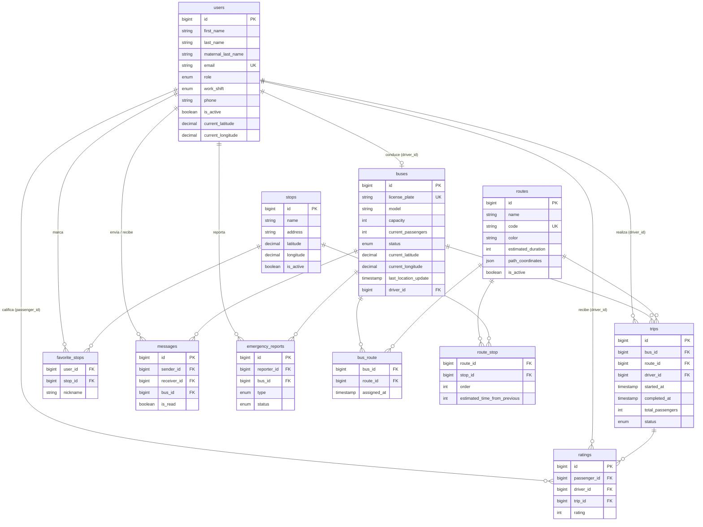

# Base de datos

La aplicación usa **SQLite** por defecto (`database/database.sqlite`). El esquema se define íntegramente mediante migraciones en `database/migrations` y se puebla con seeders en `database/seeders`.

> La vista completa con diagramas de clases, de objetos, modelo E-R, modelo relacional y el diccionario de datos de cada tabla está en [Diagramas y diccionario de datos](11-diagramas.md).

## Diagrama entidad-relación



## Tablas

### Tablas de dominio

| Tabla | Descripción | Claves foráneas y comportamiento al borrar |
|-------|-------------|--------------------------------------------|
| `users` | Usuarios y roles. | — |
| `buses` | Flota de autobuses. | `driver_id → users` (**set null**) |
| `routes` | Rutas de transporte. | — |
| `stops` | Paradas. | — |
| `bus_route` | Asignación autobús ↔ ruta. | `bus_id`, `route_id` (**cascade**) |
| `route_stop` | Paradas de cada ruta con orden y tiempo desde la anterior. | `route_id`, `stop_id` (**cascade**) |
| `trips` | Viajes. | `bus_id`, `route_id`, `driver_id → users` (**cascade**) |
| `ratings` | Calificaciones. | `passenger_id`, `driver_id` (**cascade**); `trip_id` (**set null**) |
| `favorite_stops` | Paradas favoritas. Índice único (`user_id`, `stop_id`). | `user_id`, `stop_id` (**cascade**) |
| `emergency_reports` | Reportes de emergencia. | `reporter_id` (**cascade**); `bus_id` (**set null**) |
| `messages` | Mensajes entre usuarios. | `sender_id`, `receiver_id`, `bus_id` (**cascade**) |

### Tablas de infraestructura de Laravel

| Tabla | Uso |
|-------|-----|
| `password_reset_tokens` | Tokens de recuperación de contraseña. |
| `sessions` | Sesiones de usuario (`SESSION_DRIVER=database`). |
| `cache`, `cache_locks` | Caché (`CACHE_STORE=database`). |
| `jobs`, `job_batches`, `failed_jobs` | Colas (`QUEUE_CONNECTION=database`). |
| `migrations` | Control de migraciones ejecutadas. |

### Valores enumerados

| Columna | Valores |
|---------|---------|
| `users.role` | `admin`, `driver`, `passenger` |
| `users.work_shift` | `morning` (6:00–14:00), `afternoon` (14:00–22:00) |
| `buses.status` | `active`, `inactive`, `maintenance`, `emergency` |
| `trips.status` | `in_progress`, `completed`, `cancelled` |
| `emergency_reports.type` | `accident`, `breakdown`, `medical`, `security`, `other` |
| `emergency_reports.status` | `pending`, `in_progress`, `resolved` |

Las coordenadas se almacenan como `decimal(10, 7)`, lo que ofrece precisión de aproximadamente un centímetro.

## Migraciones

Se ejecutan en orden cronológico según el prefijo del nombre del archivo:

| Migración | Acción |
|-----------|--------|
| `0001_01_01_000000_create_users_table` | Crea `users`, `password_reset_tokens` y `sessions` (base de Laravel). |
| `0001_01_01_000001_create_cache_table` | Crea `cache` y `cache_locks`. |
| `0001_01_01_000002_create_jobs_table` | Crea `jobs`, `job_batches` y `failed_jobs`. |
| `2025_12_10_201755_add_role_to_users_table` | Agrega `role`, `phone`, `avatar`, `is_active` y ubicación a `users`. |
| `2025_12_10_201756_create_buses_table` | Crea `buses`. |
| `2025_12_10_201757_create_routes_table` | Crea `routes`. |
| `2025_12_10_201758_create_stops_table` | Crea `stops`. |
| `2025_12_10_201759_create_bus_route_table` | Crea el pivote `bus_route`. |
| `2025_12_10_201800_create_route_stop_table` | Crea el pivote `route_stop`. |
| `2025_12_10_201801_create_trips_table` | Crea `trips`. |
| `2025_12_10_201802_create_messages_table` | Crea `messages`. |
| `2025_12_10_201803_create_ratings_table` | Crea `ratings`. |
| `2025_12_10_201804_create_favorite_stops_table` | Crea `favorite_stops`. |
| `2025_12_10_201805_create_emergency_reports_table` | Crea `emergency_reports`. |
| `2025_12_15_000001_update_users_table_split_name` | Divide `name` en `first_name`, `last_name` y `maternal_last_name`, migrando los datos existentes, y elimina `name`. Es reversible. |
| `2025_12_15_215605_add_work_shift_to_users_table` | Agrega `work_shift` a `users`. |

Comandos útiles:

```bash
php artisan migrate               # Ejecutar migraciones pendientes
php artisan migrate:status        # Ver estado de cada migración
php artisan migrate:rollback      # Revertir el último lote
php artisan migrate:fresh --seed  # Recrear todo y poblar
```

## Seeders

### DatabaseSeeder (principal)

Es el que se ejecuta con `php artisan db:seed` y genera un escenario completo y realista de Oaxaca:

| Entidad | Cantidad | Detalle |
|---------|----------|---------|
| Administrador | 1 | `admin@ubicaditos.com` / `password` |
| Conductores | 100 | `chofer1@` … `chofer100@ubicaditos.com` / `password` |
| Pasajeros | 600 | `pasajero1@` … `pasajero600@ubicaditos.com` / `password`, con ubicación aleatoria cerca del centro |
| Paradas | 50 | Puntos reales: Zócalo, Santo Domingo, ADO, Tule, Xoxocotlán, Etla, Aeropuerto, etc. |
| Rutas | 18 | `OAX-101` a `OAX-118`, cada una con color propio y 14–17 paradas ordenadas con tiempos entre paradas |
| Autobuses | 54 | 3 por ruta, activos, ubicados en la primera parada y con conductor asignado |
| Viajes | ~1,900 | 20–50 por autobús, distribuidos en los últimos 60 días entre 6:00 y 22:00 |
| Calificaciones | ~70 % de los viajes | Distribución sesgada hacia 4 y 5 estrellas |

El `path_coordinates` que genera este seeder es aproximado (puntos intermedios con desplazamiento aleatorio). Para obtener trazos que sigan las calles, ejecutar después `php artisan routes:generate-paths`.

> Debido a que crea 700 usuarios con `Hash::make`, el seeder puede tardar algunos segundos.

### Seeders auxiliares

Se ejecutan de forma individual con `php artisan db:seed --class=NombreSeeder`. Son versiones anteriores o complementarias del escenario de datos:

| Seeder | Propósito | Estado |
|--------|-----------|--------|
| `OaxacaRoutesSeeder` | Agrega rutas adicionales de Oaxaca (Centro–Monte Albán `OAX-106`, Etla–Centro `OAX-107`, etc.). | Los códigos pueden chocar con los de `DatabaseSeeder`. |
| `ExtendedRoutesSeeder` | Agrega rutas largas hacia Tlacolula, Ocotlán y otras localidades (`OAX-109`, `OAX-110`, …). | Los códigos pueden chocar con los de `DatabaseSeeder`. |
| `FixRoutesSeeder` | Elimina rutas demasiado largas y crea rutas más cortas sobre calles reales (`OAX-201`, `OAX-202`, …). | Funcional sobre datos previos. |
| `UpdateRoutePathsSeeder` | Reescribe `path_coordinates` detallados para `OAX-106`, `OAX-107` y `OAX-108`. | Funcional. |
| `TransportSystemSeeder` | Escenario original con rutas en Ciudad de México. | **Obsoleto:** usa el campo `name` eliminado de `users`. |
| `TestDataSeeder` | Genera 100 conductores, 150 pasajeros, 50 autobuses y viajes. | **Obsoleto:** usa el campo `name` eliminado de `users`. |

## Factories

`database/factories/UserFactory.php` es la factory por defecto de Laravel. Todavía genera el atributo `name`, por lo que debe actualizarse para usar `first_name`, `last_name`, `maternal_last_name` y `role` (ver [Pruebas y estado del proyecto](10-pruebas-y-estado.md)).
