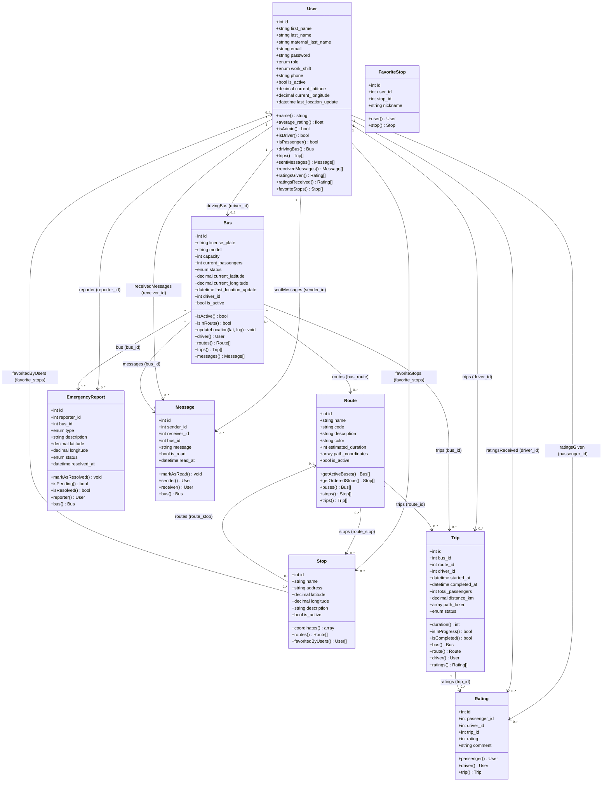
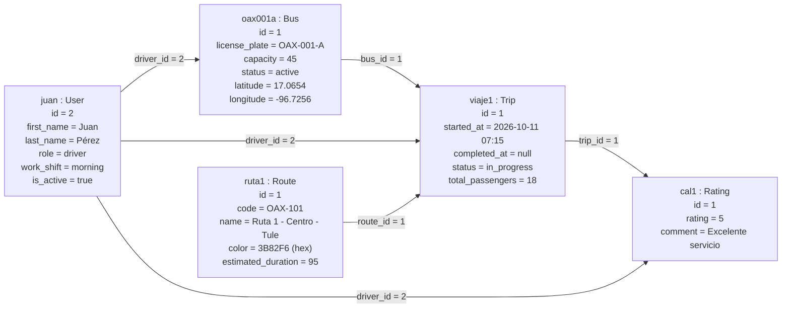
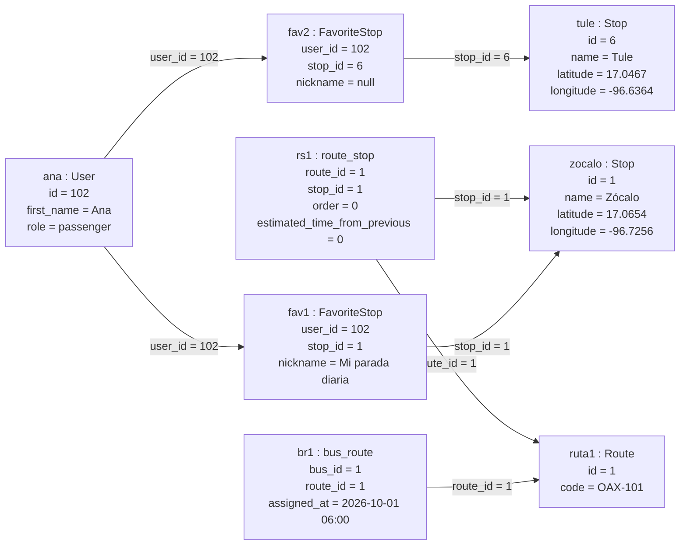
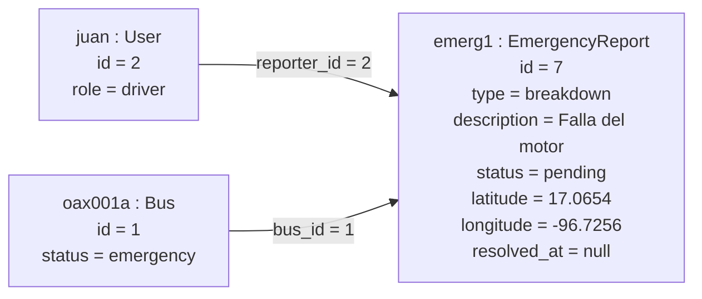
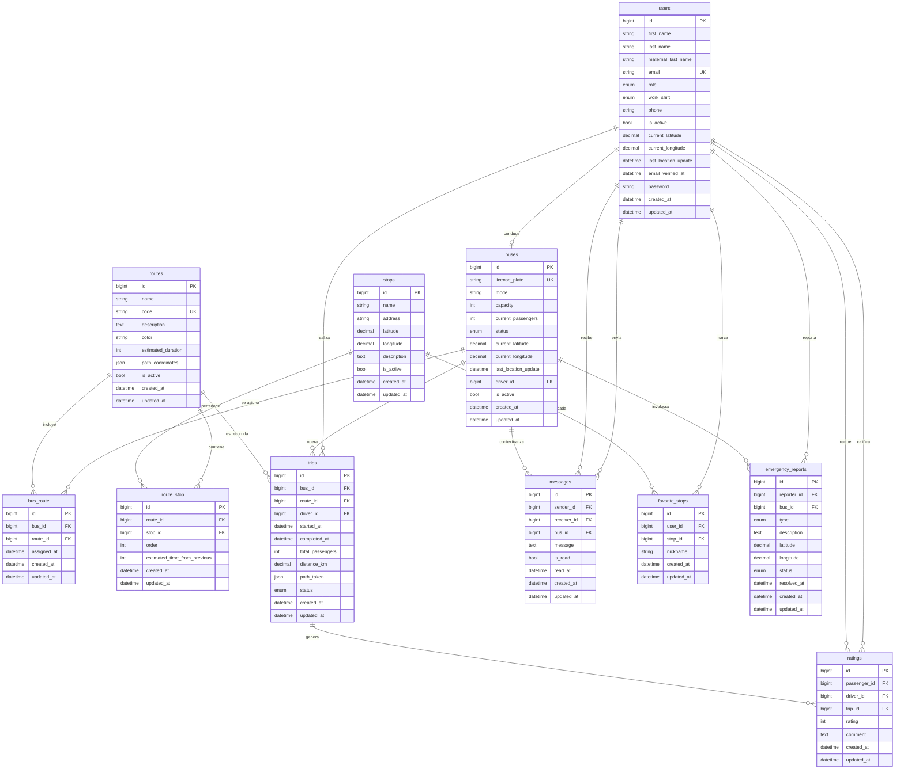
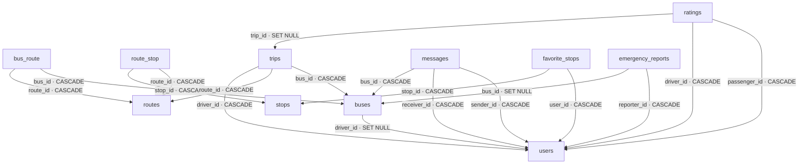

# Diagramas y diccionario de datos

Este documento reúne las vistas de modelado del sistema Ubicaditos: el **diagrama de clases**, los **diagramas de objetos**, el **modelo entidad-relación (E-R)**, el **modelo relacional** y el **diccionario de datos** completo.

Todos los diagramas usan **Mermaid** y se renderizan directamente en GitHub. Mermaid no dispone de un tipo nativo de "diagrama de objetos", por lo que ese modelo se representa con un `flowchart` cuyos nodos son las instancias y cuyas flechas son los enlaces entre objetos.

Para el contexto de cada modelo y su lógica de negocio, consultar [Modelos](04-modelos.md) y [Base de datos](05-base-de-datos.md).

## 1. Diagrama de clases

Muestra las clases del dominio (modelos Eloquent), sus atributos, sus métodos y las relaciones entre ellas con su multiplicidad.



### Notas del diagrama de clases

| Aspecto | Detalle |
|---------|---------|
| `current_passengers` | Existe como columna en `buses`, pero **no** está en `$fillable` del modelo `Bus`, por lo que las asignaciones masivas se ignoran. |
| `available_seats` | Se menciona en `DashboardController@getActiveBuses`, pero **no** es un atributo del modelo; siempre se serializa como `null`. |
| `path_coordinates` | Se castea a `array` (columna JSON en `routes`). |
| `path_taken` | Se castea a `array` (columna JSON en `trips`), reservado y sin uso actual. |
| `name`, `average_rating`, `duration`, `coordinates` | No son columnas: son accesores de Eloquent (se muestran con paréntesis). |
| `FavoriteStop` | Modelo explícito de la tabla pivote; sin embargo, la gestión se hace con `attach()` / `detach()` desde `User::favoriteStops()`. |

## 2. Diagramas de objetos

Un diagrama de objetos muestra una **instantánea** del sistema en un momento dado: instancias concretas (objetos) y los enlaces entre ellas con sus valores. Se representan aquí con `flowchart`; los nodos son objetos con su nombre y sus atributos, y las etiquetas de las flechas son las claves foráneas que materializan el enlace.

### 2.1 Escenario: viaje en curso

Un conductor con su autobús en una ruta, un viaje activo y la calificación que recibió.



### 2.2 Escenario: pasajero, favoritos y enlaces muchos a muchos

Un pasajero con paradas favoritas y una calificación emitida. Los objetos de enlace (`FavoriteStop`, `bus_route`, `route_stop`) resuelven las relaciones de muchos a muchos.



### 2.3 Escenario: reporte de emergencia

El conductor reporta una emergencia asociada a su autobús.



## 3. Modelo entidad-relación (E-R)

Modelo **conceptual**: entidades, atributos (con claves primarias y foráneas marcadas) y relaciones con su cardinalidad en notación de pata de gallo (*crow's foot*).



### Cardinalidades

| Relación | Cardinalidad | Descripción |
|----------|--------------|-------------|
| `users` – `buses` | 1 : 0..1 | Un conductor puede tener asignado como máximo un autobús (`buses.driver_id`). |
| `users` – `trips` | 1 : 0..* | Un conductor realiza muchos viajes. |
| `users` – `ratings` (pasajero) | 1 : 0..* | Un pasajero emite muchas calificaciones. |
| `users` – `ratings` (conductor) | 1 : 0..* | Un conductor recibe muchas calificaciones. |
| `users` – `stops` (favoritos) | 0..* : 0..* | Resuelta por `favorite_stops`, con restricción única (usuario, parada). |
| `users` – `messages` | 1 : 0..* | Cada mensaje tiene un emisor y un receptor. |
| `users` – `emergency_reports` | 1 : 0..* | Un usuario reporta muchas emergencias. |
| `buses` – `routes` | 0..* : 0..* | Resuelta por `bus_route`. |
| `routes` – `stops` | 0..* : 0..* | Resuelta por `route_stop`, con `order` y tiempo entre paradas. |
| `buses` – `trips` | 1 : 0..* | Un autobús opera muchos viajes. |
| `routes` – `trips` | 1 : 0..* | Una ruta es recorrida en muchos viajes. |
| `trips` – `ratings` | 1 : 0..* | Un viaje puede generar varias calificaciones. |
| `buses` – `emergency_reports` | 1 : 0..* | Un autobús puede estar involucrado en varios reportes. |
| `buses` – `messages` | 1 : 0..* | Un mensaje puede referenciar un autobús (opcional). |

## 4. Modelo relacional

Transformación del modelo E-R al **modelo lógico relacional**. Cada relación (tabla) se expresa con sus atributos; **PK** marca la clave primaria, **FK** la foránea y **UK** una clave única.

### 4.1 Esquema relacional

```text
users (
    id PK,
    first_name, last_name, maternal_last_name,
    email UK, password, email_verified_at,
    role, work_shift, phone, avatar, is_active,
    current_latitude, current_longitude, last_location_update,
    created_at, updated_at
)

buses (
    id PK,
    license_plate UK, model, capacity, current_passengers, status,
    current_latitude, current_longitude, last_location_update,
    driver_id FK → users.id,
    is_active, created_at, updated_at
)

routes (
    id PK,
    name, code UK, description, color,
    estimated_duration, path_coordinates, is_active,
    created_at, updated_at
)

stops (
    id PK,
    name, address, latitude, longitude, description, is_active,
    created_at, updated_at
)

bus_route (
    id PK,
    bus_id FK → buses.id,
    route_id FK → routes.id,
    assigned_at, created_at, updated_at
)

route_stop (
    id PK,
    route_id FK → routes.id,
    stop_id FK → stops.id,
    "order", estimated_time_from_previous,
    created_at, updated_at
)

trips (
    id PK,
    bus_id FK → buses.id,
    route_id FK → routes.id,
    driver_id FK → users.id,
    started_at, completed_at, total_passengers,
    distance_km, path_taken, status,
    created_at, updated_at
)

messages (
    id PK,
    sender_id FK → users.id,
    receiver_id FK → users.id,
    bus_id FK → buses.id,
    message, is_read, read_at,
    created_at, updated_at
)

ratings (
    id PK,
    passenger_id FK → users.id,
    driver_id FK → users.id,
    trip_id FK → trips.id,
    rating, comment, created_at, updated_at
)

favorite_stops (
    id PK,
    user_id FK → users.id,
    stop_id FK → stops.id,
    nickname, created_at, updated_at,
    UNIQUE (user_id, stop_id)
)

emergency_reports (
    id PK,
    reporter_id FK → users.id,
    bus_id FK → buses.id,
    type, description, latitude, longitude, status, resolved_at,
    created_at, updated_at
)
```

Normalización: el esquema está en **tercera forma normal (3FN)**. Los datos que se repiten en varias filas (por ejemplo, la posición del autobús y el contador de pasajeros) se guardan una sola vez en `buses`; las relaciones de muchos a muchos se resuelven con las tablas asociativas `bus_route`, `route_stop` y `favorite_stops`, cuyos atributos (como `order`, `estimated_time_from_previous` y `nickname`) dependen de la clave compuesta del enlace y no de una sola entidad.

### 4.2 Diagrama relacional e integridad referencial

Dependencias entre relaciones por clave foránea. La flecha va del **hijo** que contiene la foránea al **padre** referenciado, e indica la política de borrado.



### 4.3 Reglas de integridad

| Regla | Descripción |
|-------|-------------|
| Integridad de entidad | Toda relación tiene una clave primaria `id` que no admite nulos y es única. |
| Integridad referencial | Toda clave foránea apunta a una clave primaria existente en el padre. |
| Borrado en cascada (CASCADE) | Al eliminar el padre se eliminan sus filas hijas: autobús ↔ ruta, ruta ↔ parada, viajes, mensajes, calificaciones y reportes. |
| Borrado con SET NULL | Al eliminar el padre la foránea se vuelve nula: `buses.driver_id`, `ratings.trip_id` y `emergency_reports.bus_id`, que son datos opcionales. |
| Clave única compuesta | `favorite_stops` impide duplicados con `UNIQUE (user_id, stop_id)`. |

## 5. Diccionario de datos

Definición de cada columna de la base de datos. Los tipos se indican con la nomenclatura SQL y el equivalente en el esquema de Laravel entre paréntesis.

Leyenda de columnas: **PK** = clave primaria, **FK** = clave foránea, **UK** = clave única, **NN** = no admite nulos.

### 5.1 users

Usuarios del sistema: administradores, conductores y pasajeros.

| Columna | Tipo | Nulo | Clave | Defecto | Descripción |
|---------|------|------|-------|---------|-------------|
| `id` | BIGINT UNSIGNED (id) | No | PK | autoincremental | Identificador único. |
| `first_name` | VARCHAR(255) | No | | | Nombre. |
| `last_name` | VARCHAR(255) | No | | | Apellido paterno. |
| `maternal_last_name` | VARCHAR(255) | Sí | | NULL | Apellido materno. |
| `email` | VARCHAR(255) | No | UK | | Correo de acceso; único. |
| `role` | ENUM('admin','driver','passenger') | No | | passenger | Rol del usuario. |
| `work_shift` | ENUM('morning','afternoon') | Sí | | NULL | Turno del conductor (solo conductores). |
| `phone` | VARCHAR(255) | Sí | | NULL | Teléfono de 10 dígitos. |
| `avatar` | VARCHAR(255) | Sí | | NULL | Ruta de la imagen de perfil (sin uso actual). |
| `is_active` | BOOLEAN | No | | true | Habilitado en el sistema. |
| `current_latitude` | DECIMAL(10,7) | Sí | | NULL | Última latitud conocida. |
| `current_longitude` | DECIMAL(10,7) | Sí | | NULL | Última longitud conocida. |
| `last_location_update` | TIMESTAMP | Sí | | NULL | Fecha de la última ubicación. |
| `email_verified_at` | TIMESTAMP | Sí | | NULL | Fecha de verificación del correo. |
| `password` | VARCHAR(255) | No | | | Contraseña cifrada (bcrypt). |
| `remember_token` | VARCHAR(100) | Sí | | NULL | Token de "recordarme". |
| `created_at` | TIMESTAMP | Sí | | NULL | Fecha de creación. |
| `updated_at` | TIMESTAMP | Sí | | NULL | Fecha de actualización. |

### 5.2 buses

Flota de autobuses y su ubicación actual.

| Columna | Tipo | Nulo | Clave | Defecto | Descripción |
|---------|------|------|-------|---------|-------------|
| `id` | BIGINT UNSIGNED (id) | No | PK | autoincremental | Identificador único. |
| `license_plate` | VARCHAR(255) | No | UK | | Placa del autobús. |
| `model` | VARCHAR(255) | Sí | | NULL | Modelo del vehículo. |
| `capacity` | INT | No | | | Capacidad de pasajeros. |
| `current_passengers` | INT | No | | 0 | Pasajeros a bordo (no asignable en el modelo `Bus`). |
| `status` | ENUM('active','inactive','maintenance','emergency') | No | | inactive | Estado operativo. |
| `current_latitude` | DECIMAL(10,7) | Sí | | NULL | Latitud GPS actual. |
| `current_longitude` | DECIMAL(10,7) | Sí | | NULL | Longitud GPS actual. |
| `last_location_update` | TIMESTAMP | Sí | | NULL | Fecha de la última posición recibida. |
| `driver_id` | BIGINT UNSIGNED | Sí | FK → `users.id` | NULL | Conductor asignado (SET NULL al borrar). |
| `is_active` | BOOLEAN | No | | true | Habilitado en el sistema. |
| `created_at` | TIMESTAMP | Sí | | NULL | Fecha de creación. |
| `updated_at` | TIMESTAMP | Sí | | NULL | Fecha de actualización. |

### 5.3 routes

Rutas de transporte.

| Columna | Tipo | Nulo | Clave | Defecto | Descripción |
|---------|------|------|-------|---------|-------------|
| `id` | BIGINT UNSIGNED (id) | No | PK | autoincremental | Identificador único. |
| `name` | VARCHAR(255) | No | | | Nombre de la ruta. |
| `code` | VARCHAR(255) | No | UK | | Código de la ruta (ej. `OAX-101`). |
| `description` | TEXT | Sí | | NULL | Descripción. |
| `color` | VARCHAR(7) | No | | #3B82F6 | Color hexadecimal del trazo. |
| `estimated_duration` | INT | Sí | | NULL | Duración estimada en minutos. |
| `path_coordinates` | JSON | Sí | | NULL | Lista de puntos `{lat, lng}` del trazo. |
| `is_active` | BOOLEAN | No | | true | Visible para los pasajeros. |
| `created_at` | TIMESTAMP | Sí | | NULL | Fecha de creación. |
| `updated_at` | TIMESTAMP | Sí | | NULL | Fecha de actualización. |

### 5.4 stops

Paradas físicas.

| Columna | Tipo | Nulo | Clave | Defecto | Descripción |
|---------|------|------|-------|---------|-------------|
| `id` | BIGINT UNSIGNED (id) | No | PK | autoincremental | Identificador único. |
| `name` | VARCHAR(255) | No | | | Nombre de la parada. |
| `address` | VARCHAR(255) | Sí | | NULL | Dirección o referencia. |
| `latitude` | DECIMAL(10,7) | No | | | Latitud. |
| `longitude` | DECIMAL(10,7) | No | | | Longitud. |
| `description` | TEXT | Sí | | NULL | Descripción. |
| `is_active` | BOOLEAN | No | | true | Visible en el mapa. |
| `created_at` | TIMESTAMP | Sí | | NULL | Fecha de creación. |
| `updated_at` | TIMESTAMP | Sí | | NULL | Fecha de actualización. |

### 5.5 bus_route

Tabla asociativa autobús ↔ ruta.

| Columna | Tipo | Nulo | Clave | Defecto | Descripción |
|---------|------|------|-------|---------|-------------|
| `id` | BIGINT UNSIGNED (id) | No | PK | autoincremental | Identificador único. |
| `bus_id` | BIGINT UNSIGNED | No | FK → `buses.id` | | Autobús (CASCADE). |
| `route_id` | BIGINT UNSIGNED | No | FK → `routes.id` | | Ruta (CASCADE). |
| `assigned_at` | TIMESTAMP | No | | CURRENT_TIMESTAMP | Fecha de asignación. |
| `created_at` | TIMESTAMP | Sí | | NULL | Fecha de creación. |
| `updated_at` | TIMESTAMP | Sí | | NULL | Fecha de actualización. |

### 5.6 route_stop

Tabla asociativa ruta ↔ parada, con el orden y el tiempo entre paradas.

| Columna | Tipo | Nulo | Clave | Defecto | Descripción |
|---------|------|------|-------|---------|-------------|
| `id` | BIGINT UNSIGNED (id) | No | PK | autoincremental | Identificador único. |
| `route_id` | BIGINT UNSIGNED | No | FK → `routes.id` | | Ruta (CASCADE). |
| `stop_id` | BIGINT UNSIGNED | No | FK → `stops.id` | | Parada (CASCADE). |
| `order` | INT | No | | 0 | Posición de la parada dentro de la ruta. |
| `estimated_time_from_previous` | INT | Sí | | NULL | Minutos desde la parada anterior. |
| `created_at` | TIMESTAMP | Sí | | NULL | Fecha de creación. |
| `updated_at` | TIMESTAMP | Sí | | NULL | Fecha de actualización. |

### 5.7 trips

Viajes realizados.

| Columna | Tipo | Nulo | Clave | Defecto | Descripción |
|---------|------|------|-------|---------|-------------|
| `id` | BIGINT UNSIGNED (id) | No | PK | autoincremental | Identificador único. |
| `bus_id` | BIGINT UNSIGNED | No | FK → `buses.id` | | Autobús (CASCADE). |
| `route_id` | BIGINT UNSIGNED | No | FK → `routes.id` | | Ruta (CASCADE). |
| `driver_id` | BIGINT UNSIGNED | No | FK → `users.id` | | Conductor (CASCADE). |
| `started_at` | TIMESTAMP | No | | | Inicio del viaje. |
| `completed_at` | TIMESTAMP | Sí | | NULL | Fin del viaje. |
| `total_passengers` | INT | No | | 0 | Pasajeros transportados. |
| `distance_km` | DECIMAL(8,2) | Sí | | NULL | Distancia recorrida en km. |
| `path_taken` | JSON | Sí | | NULL | Trayectoria real (reservado). |
| `status` | ENUM('in_progress','completed','cancelled') | No | | in_progress | Estado del viaje. |
| `created_at` | TIMESTAMP | Sí | | NULL | Fecha de creación. |
| `updated_at` | TIMESTAMP | Sí | | NULL | Fecha de actualización. |

### 5.8 messages

Mensajes entre usuarios (sin interfaz implementada).

| Columna | Tipo | Nulo | Clave | Defecto | Descripción |
|---------|------|------|-------|---------|-------------|
| `id` | BIGINT UNSIGNED (id) | No | PK | autoincremental | Identificador único. |
| `sender_id` | BIGINT UNSIGNED | No | FK → `users.id` | | Emisor (CASCADE). |
| `receiver_id` | BIGINT UNSIGNED | No | FK → `users.id` | | Receptor (CASCADE). |
| `bus_id` | BIGINT UNSIGNED | Sí | FK → `buses.id` | NULL | Autobús relacionado (CASCADE). |
| `message` | TEXT | No | | | Contenido del mensaje. |
| `is_read` | BOOLEAN | No | | false | Indica si fue leído. |
| `read_at` | TIMESTAMP | Sí | | NULL | Fecha de lectura. |
| `created_at` | TIMESTAMP | Sí | | NULL | Fecha de creación. |
| `updated_at` | TIMESTAMP | Sí | | NULL | Fecha de actualización. |

### 5.9 ratings

Calificaciones de pasajeros a conductores.

| Columna | Tipo | Nulo | Clave | Defecto | Descripción |
|---------|------|------|-------|---------|-------------|
| `id` | BIGINT UNSIGNED (id) | No | PK | autoincremental | Identificador único. |
| `passenger_id` | BIGINT UNSIGNED | No | FK → `users.id` | | Pasajero que califica (CASCADE). |
| `driver_id` | BIGINT UNSIGNED | No | FK → `users.id` | | Conductor calificado (CASCADE). |
| `trip_id` | BIGINT UNSIGNED | Sí | FK → `trips.id` | NULL | Viaje asociado (SET NULL). |
| `rating` | INT UNSIGNED | No | | | Valor de 1 a 5. |
| `comment` | TEXT | Sí | | NULL | Comentario opcional. |
| `created_at` | TIMESTAMP | Sí | | NULL | Fecha de creación. |
| `updated_at` | TIMESTAMP | Sí | | NULL | Fecha de actualización. |

### 5.10 favorite_stops

Paradas favoritas de los usuarios.

| Columna | Tipo | Nulo | Clave | Defecto | Descripción |
|---------|------|------|-------|---------|-------------|
| `id` | BIGINT UNSIGNED (id) | No | PK | autoincremental | Identificador único. |
| `user_id` | BIGINT UNSIGNED | No | FK → `users.id` | | Usuario (CASCADE). |
| `stop_id` | BIGINT UNSIGNED | No | FK → `stops.id` | | Parada (CASCADE). |
| `nickname` | VARCHAR(255) | Sí | | NULL | Alias personalizado de la parada. |
| `created_at` | TIMESTAMP | Sí | | NULL | Fecha de creación. |
| `updated_at` | TIMESTAMP | Sí | | NULL | Fecha de actualización. |

Restricción única: `UNIQUE (user_id, stop_id)`.

### 5.11 emergency_reports

Reportes de emergencia de los conductores.

| Columna | Tipo | Nulo | Clave | Defecto | Descripción |
|---------|------|------|-------|---------|-------------|
| `id` | BIGINT UNSIGNED (id) | No | PK | autoincremental | Identificador único. |
| `reporter_id` | BIGINT UNSIGNED | No | FK → `users.id` | | Usuario que reporta (CASCADE). |
| `bus_id` | BIGINT UNSIGNED | Sí | FK → `buses.id` | NULL | Autobús involucrado (SET NULL). |
| `type` | ENUM('accident','breakdown','medical','security','other') | No | | other | Tipo de emergencia. |
| `description` | TEXT | No | | | Descripción del incidente. |
| `latitude` | DECIMAL(10,7) | Sí | | NULL | Latitud del reporte. |
| `longitude` | DECIMAL(10,7) | Sí | | NULL | Longitud del reporte. |
| `status` | ENUM('pending','in_progress','resolved') | No | | pending | Estado de atención. |
| `resolved_at` | TIMESTAMP | Sí | | NULL | Fecha de resolución. |
| `created_at` | TIMESTAMP | Sí | | NULL | Fecha de creación. |
| `updated_at` | TIMESTAMP | Sí | | NULL | Fecha de actualización. |

### 5.12 Tablas de infraestructura de Laravel

Generadas por las migraciones base del framework; no forman parte del dominio de negocio.

| Tabla | Columnas principales | Propósito |
|-------|----------------------|-----------|
| `password_reset_tokens` | `email` (PK), `token`, `created_at` | Tokens de recuperación de contraseña. |
| `sessions` | `id` (PK), `user_id`, `ip_address`, `user_agent`, `payload`, `last_activity` | Sesiones (`SESSION_DRIVER=database`). |
| `cache` | `key` (PK), `value`, `expiration` | Caché (`CACHE_STORE=database`). |
| `cache_locks` | `key` (PK), `owner`, `expiration` | Bloqueos de caché. |
| `jobs` | `id` (PK), `queue`, `payload`, `attempts`, `reserved_at`, `available_at`, `created_at` | Cola de trabajos (`QUEUE_CONNECTION=database`). |
| `job_batches` | `id` (PK), `name`, `total_jobs`, `pending_jobs`, `failed_jobs`, `failed_job_ids`, `options`, `cancelled_at`, `created_at`, `finished_at` | Lotes de trabajos. |
| `failed_jobs` | `id` (PK), `uuid` (UK), `connection`, `queue`, `payload`, `exception`, `failed_at` | Trabajos fallidos. |
| `migrations` | `id` (PK), `migration`, `batch` | Control de migraciones ejecutadas. |

### 5.13 Dominios de valores

| Columna | Valores permitidos | Significado |
|---------|--------------------|-------------|
| `users.role` | `admin`, `driver`, `passenger` | Rol y ámbito de acceso. |
| `users.work_shift` | `morning`, `afternoon` | Turno matutino (6–14 h) o vespertino (14–22 h). |
| `buses.status` | `active`, `inactive`, `maintenance`, `emergency` | Estado operativo del autobús. |
| `trips.status` | `in_progress`, `completed`, `cancelled` | Estado del viaje. |
| `emergency_reports.type` | `accident`, `breakdown`, `medical`, `security`, `other` | Naturaleza del incidente. |
| `emergency_reports.status` | `pending`, `in_progress`, `resolved` | Grado de atención del reporte. |
| `ratings.rating` | 1 a 5 | Calificación del conductor. |

## 6. Índices y restricciones

| Tabla | Restricción | Tipo | Columnas |
|-------|-------------|------|----------|
| `users` | `users_email_unique` | Único | `email` |
| `buses` | `buses_license_plate_unique` | Único | `license_plate` |
| `routes` | `routes_code_unique` | Único | `code` |
| `favorite_stops` | `favorite_stops_user_id_stop_id_unique` | Único compuesto | `user_id`, `stop_id` |
| `sessions` | `sessions_user_id_index` | Índice | `user_id` |
| `sessions` | `sessions_last_activity_index` | Índice | `last_activity` |
| `jobs` | `jobs_queue_index` | Índice | `queue` |
| `failed_jobs` | `failed_jobs_uuid_unique` | Único | `uuid` |
| `password_reset_tokens` | Clave primaria | PK | `email` |
