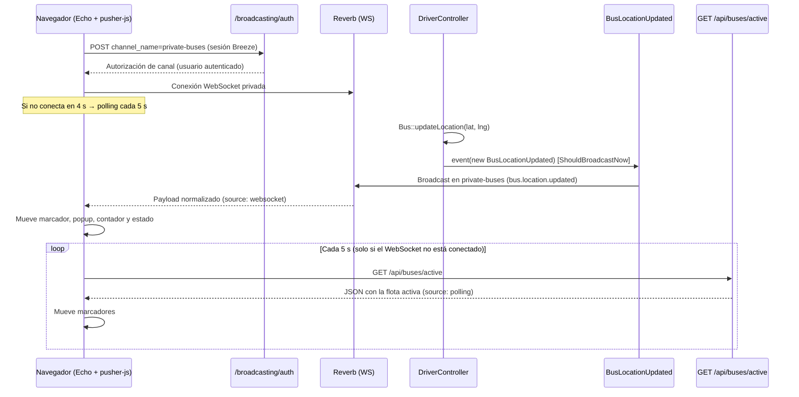
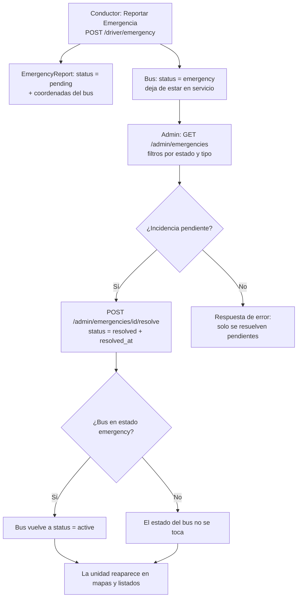

# Iteración 3 — Tiempo real, búsqueda e incidencias

La iteración 3 convierte a Ubicaditos en una aplicación con **mapa interactivo y posiciones en vivo** (WebSockets con Laravel Reverb y fallback de sondeo), incorpora **búsqueda y filtros de autobuses** para el pasajero, **estadísticas del conductor**, el **ciclo completo de incidencias** (conductor reporta, administrador resuelve, unidad vuelve al servicio) y un **restyle responsive** de todas las vistas restantes. Se desarrolló con flujo **TDD** (pruebas en rojo primero, implementación, verde); el estado final de la rama `develop` es **86 pruebas / 289 aserciones en verde** (`php artisan test`, SQLite en memoria).

## Objetivo y alcance

| # | Objetivo | Resultado |
|---|----------|-----------|
| 1 | Tiempo real de posiciones de la flota | Laravel Reverb + evento `BusLocationUpdated` + módulo `resources/js/realtime.js` con fallback de polling |
| 2 | Búsqueda y filtros de autobuses | Filtros en servidor (`q`, `route_id`, `status`, `sort`) + refinamiento instantáneo en cliente |
| 3 | Detalle de autobús (admin) | `Admin\BusController@show` con KPIs, viajes recientes y emergencias |
| 4 | Ciclo de viaje y GPS automático | Inicio/fin con validaciones; interruptor de compartir ubicación persistente; simulación con deriva |
| 5 | Estadísticas del conductor | `DriverController@statistics` con KPIs, gráfica de barras y desglose por ruta |
| 6 | Incidencias (ciclo completo) | Reporte del conductor, listado filtrable del admin, resolución solo de pendientes y vuelta de la unidad a servicio |
| 7 | Restyle responsive | Todas las vistas restantes al estilo cristal del proyecto, usable a 375×667 |
| 8 | Pruebas automatizadas | Suites nuevas de tiempo real, filtros, viajes, estadísticas, incidencias y detalle de autobús (TDD) |
| 9 | Pruebas E2E | Scripts de Selenium WebDriver en `tests/selenium/` (ejecución pendiente en la rama de pruebas) |
| 10 | Pruebas de carga | Script k6 de solo lectura en `tests/load/ubicaditos-iteration3-load.js` (ejecución pendiente) |
| 11 | Documentación y swagger | Este documento, actualización de `10-pruebas-y-estado.md`, `_devlog.md`, `README.md` y `docs/swagger.yaml` |

## Tiempo real con Laravel Reverb

### Instalación y configuración

| Elemento | Detalle |
|----------|---------|
| Paquete | `laravel/reverb` **v1.12** (`composer.json`, `composer.lock`); solución oficial de broadcasting, sin servicios externos |
| Conexión | `BROADCAST_CONNECTION=reverb` (`.env.example`, `.env.production.example`, `.env.staging.example`) |
| Credenciales | `REVERB_APP_ID`, `REVERB_APP_KEY`, `REVERB_APP_SECRET`, `REVERB_HOST`, `REVERB_PORT`, `REVERB_SCHEME` (generables con `php artisan reverb:generate`) |
| Variables de cliente | `VITE_REVERB_APP_KEY`, `VITE_REVERB_HOST`, `VITE_REVERB_PORT`, `VITE_REVERB_SCHEME` (inyectadas a Vite) |
| Configuración | `config/reverb.php` (publicado por el paquete) |
| Pruebas | `phpunit.xml` fija `BROADCAST_CONNECTION=null`; las pruebas de broadcasting la anulan localmente con `config([...])` |

En desarrollo, el WebSocket requiere arrancar `php artisan reverb:start`; si no está corriendo, el frontend cae automáticamente al sondeo (ver más abajo), por lo que la aplicación nunca queda sin datos.

### Evento BusLocationUpdated

`app/Events/BusLocationUpdated.php` se emite con cada actualización GPS (lo despacha `Bus::updateLocation()`, llamada desde `DriverController@updateLocation`):

| Aspecto | Detalle |
|---------|---------|
| Contrato | `ShouldBroadcastNow`: se publica **en el mismo request**, sin depender de un worker de colas (posiciones que no deben esperar) |
| Canal | `PrivateChannel('buses')` → `private-buses` |
| Nombre | `broadcastAs()` → `bus.location.updated` (estable para los clientes Echo) |
| Payload | `id`, `license_plate`, `latitude`, `longitude` (floats), `status`, `current_passengers`, `available_seats`, `route_id` (primera ruta del bus), `last_update` (ISO 8601) |

### Autorización de canales

`routes/channels.php` autoriza el canal `buses` a **cualquier usuario autenticado** (pasajero, conductor o administrador), en línea con los endpoints JSON `/api/*`, que también están abiertos a toda sesión autenticada:

```php
Broadcast::channel('buses', function ($user) {
    return $user !== null;
});
```

El archivo se registra en `bootstrap/app.php` mediante `->withRouting(channels: __DIR__.'/../routes/channels.php')`; la ruta `/broadcasting/auth` queda auto-registrada por Laravel para la autorización de canales privados desde el cliente.

### Módulo frontend realtime.js

`resources/js/realtime.js` (importado desde `resources/js/app.js`, que es el punto de entrada compilado por Vite con `bun run build`) expone un módulo global `window.UbicaditosRealtime`:

| Método | Descripción |
|--------|-------------|
| `UbicaditosRealtime.start({key, host, pollInterval, ...})` | Arranca la instancia singleton: descarga inicial por HTTP, intenta WebSocket y activa el polling de respaldo |
| `rt.onBusLocation(cb)` | Suscriptor de posiciones (payload normalizado) |
| `rt.onStatus(cb)` | Suscriptor de estado de conexión: `'websocket'`, `'polling'` u `'offline'` |
| `rt.refresh()` | Descarga puntual completa de `GET /api/buses/active` |
| `rt.stop()` | Detiene sondeo, timer de WebSocket y suscripción Echo |

Estrategia (ambas fuentes emiten **el mismo payload normalizado**):

1. Primera descarga siempre por HTTP (`GET /api/buses/active`) para tener el estado completo al abrir la página.
2. Se intenta el canal privado `private-buses` vía Echo + pusher-js (broadcaster `reverb`); si conecta dentro de `wsTimeout` (4 s), el polling se apaga.
3. Si el WebSocket no conecta o se cae, el polling consulta `/api/buses/active` cada `pollInterval` (5 s por defecto).

Payload normalizado entregue a los suscriptores, común a WebSocket y polling:

```text
{ id, license_plate, latitude, longitude, status, current_passengers,
  available_seats, route_id, last_update, source, received_at }
```

`source` identifica el origen (`websocket` o `polling`); `received_at` es el instante de recepción en el cliente.

### Integración en vistas

| Vista | Integración |
|-------|-------------|
| `passenger/dashboard` | `startRealtimeUpdates()` arranca `UbicaditosRealtime`; un bus con posición real se marca `isReal`, **detiene su simulación local** y mueve su marcador; actualiza el popup con la ocupación, el contador `#fleet-counter` y el indicador `#realtime-status` ("· en vivo" / "· actualizando…" / "· sin conexión en vivo") |
| `admin/dashboard` | Igual sobre el mapa de administración (marcadores de buses reales dejan de simularse) |
| `driver/map` | El conductor es el **productor**: `sendLocationToServer()` envía la posición a `POST /driver/update-location`, que dispara el evento |
| `passenger/buses` | La búsqueda instantánea (`filterBuses()`) refina las tarjetas ya renderizadas por el servidor |

### Flujo de una actualización en tiempo real



## Búsqueda y filtrado de autobuses

### Filtros en servidor

`PassengerController@buses()` (ruta `passenger.buses`) aplica filtros combinables por query string, de modo que las URLs son compartibles y enlazables:

| Parámetro | Valores | Efecto |
|-----------|---------|--------|
| `q` | texto libre | Busca por placa, modelo o nombre del conductor (nombre, apellido paterno y materno) |
| `route_id` | id de ruta | Filtra por la ruta asignada al autobús |
| `status` | `active` (por defecto), `maintenance`, `emergency`, `all` | Filtra por estado de la unidad |
| `sort` | `plate` (por defecto), `occupancy` | Ordena por placa (A-Z) u ocupación (mayor primero) |

Además, el controlador calcula `$busDetailsData`: una colección con los datos completos de cada autobús (placa, modelo, capacidad, pasajeros, asientos disponibles, estado, ruta con color, conductor, última actualización y enlace al mapa). Calcularlo **en el controlador** (y no en la vista) permite asertarlo con `assertViewHas` en las pruebas.

### Accesorios del modelo Bus

`app/Models/Bus.php` incorpora:

| Elemento | Detalle |
|----------|---------|
| `$fillable` | Se añade `current_passengers` (corrige el error funcional nº 1 de la iteración 2: `updatePassengers` y `buses:simulate` no guardaban el conteo) |
| `available_seats` (accessor) | `max(0, capacity − current_passengers)`; nunca negativo |
| `occupancy_percentage` (accessor) | Porcentaje 0–100 de ocupación actual (0 si no hay capacidad) |
| `updateLocation($lat, $lng)` | Guarda coordenadas y `last_location_update`, y **despacha `BusLocationUpdated`** |

### Vista passenger/buses

`resources/views/passenger/buses.blade.php` fue reescrita por completo:

| Elemento | Descripción |
|----------|-------------|
| Formulario de búsqueda | Input `#bus-search` (pill, `type="search"`) que envía `q` al servidor; `oninput="filterBuses()"` refina sin recargar |
| Chips de estado | Enlaces (`#status-chips`): En servicio, Mantenimiento, Emergencia, Todos los estados; conservan los demás filtros vía `$filterUrl()` |
| Chips de ruta | Enlaces (`#route-chips`) con "Todas las rutas" + cada ruta activa, mismos colores que en el mapa |
| Selector de orden | `plate` / `occupancy` (navega al servidor) |
| Badges de estado | Punto de color + etiqueta por estado (servicio, mantenimiento, emergencia, inactivo), con variantes dark |
| Ocupación | Barra de progreso (`role="progressbar"`) con color umbral (verde / ámbar ≥60 % / rojo ≥90 %) y línea de asientos libres ("N asientos libres" / "Sin asientos libres") |
| Modal de detalles | Abre con datos de `$busDetailsData` (JSON embebido): placa, modelo, capacidad, ocupación con tile de asientos, ruta, conductor, última actualización y botón para ver en el mapa |
| `filterBuses()` | Refinamiento client-side **solo de búsqueda**: compara el texto contra `data-plate`, `data-model`, `data-driver` y `data-route` de cada `.bus-card`; muestra `#no-buses-message` y oculta la grilla si no hay coincidencias |

Los filtros de estado y ruta se resuelven en el servidor; el cliente solo refina `q`, evitando duplicar lógica de filtrado.

## Ciclo de vida del viaje y GPS automático

### Inicio y finalización de viaje

`DriverController@startTrip` / `@endTrip` (rutas `driver.start-trip` y `driver.end-trip`, con formularios en `driver/map`). El inicio valida, en orden:

| Validación | Regla |
|------------|-------|
| Conductor activo | `users.is_active` debe ser verdadero |
| Autobús asignado | Debe existir `drivingBus` con una ruta asignada |
| Sin viaje en curso | No puede haber otro `Trip` con estado `in_progress` para el conductor |
| Ventana de turno | `morning` 6:00–14:00, `afternoon` 14:00–22:00, `night` 22:00–6:00; el turno nocturno **cruza medianoche** y se compara con `hora >= inicio || hora < fin` |
| Ubicación GPS | Las coordenadas del autobús deben estar a **≤ 500 m** (Haversine) de alguna parada ordenada de la ruta; el mensaje de error indica la parada más cercana y la distancia |

El estado del autobús **no** se modifica al iniciar ni al finalizar viaje (solo el administrador lo cambia). Al finalizar, `endTrip()` registra la ocupación real del viaje: `total_passengers = current_passengers` del autobús (dato que alimenta las estadísticas).

### Compartir ubicación (interruptor persistente)

El mapa del conductor (`driver/map`) añade un panel de estado GPS con el interruptor `#share-location-toggle` ("Compartir mi ubicación"):

| Aspecto | Comportamiento |
|---------|----------------|
| Persistencia | `localStorage['ubicaditos_share_location']` (`on`/`off`); **por defecto activo** (`isSharingEnabled()` solo desactiva si el valor es exactamente `'off'`) |
| Arranque | `applySharingState()` se ejecuta al cargar: si está activo, inicia `watchPosition` (o la simulación); si no, detiene el rastreo y marca "GPS Inactivo" |
| Modo simulado | `simulatedLocationInterval` reenvía la posición cada **5 s con una deriva** (`±0.0003°`) vía `sendLocationToServer()` para que los pasajeros vean la unidad "viva" también sin GPS real |
| Clic en el mapa | En modo simulado, un clic fija una posición personalizada; **solo se envía al servidor si compartir está activado** (si no, solo se mueve el marcador local con `applySimulatedPosition()`); con viaje activo está bloqueado |
| Helpers | `sendLocationToServer(lat, lng)` → `POST /driver/update-location`; `applySimulatedPosition(lat, lng)` → solo UI |

## Estadísticas del conductor

`DriverController@statistics()` (ruta `driver.statistics`, middleware `driver`) y la vista `resources/views/driver/statistics.blade.php`. Los KPIs se calculan solo con los viajes y calificaciones del conductor autenticado:

| KPI | Cálculo |
|-----|---------|
| Viajes completados / totales / activos | Conteo por estado |
| Pasajeros transportados | Suma de `total_passengers` de viajes completados |
| Ocupación promedio | Por viaje: `total_passengers / capacidad` (máx. 100 %); **excluye viajes cuyo autobús no tenga capacidad registrada** |
| Calificación promedio | `ratingsReceived` con conteo |
| Distancia y tiempo al volante | Suma de `distance_km` y de la duración (`started_at` → `completed_at`), con promedio por viaje |
| Incidencias reportadas | Conteo de `EmergencyReport` del conductor |

La vista muestra ocho tiles de KPI, una **gráfica de barras en CSS** con los viajes de los últimos 7 días (`by_day`), el top 5 de rutas (`by_route`) y las últimas calificaciones recibidas. Accesos: enlace **"Estadísticas"** en `components/passenger-nav.blade.php` (nav del conductor) y botón **"Mis estadísticas"** en `driver/dashboard`.

## Ciclo completo de incidencias

### Reporte del conductor

`POST /driver/emergency` (`DriverController@reportEmergency`):

| Campo | Regla |
|-------|-------|
| `type` | Obligatorio, `accident` \| `breakdown` \| `medical` \| `security` \| `other` |
| `description` | Obligatoria, máximo 500 caracteres |

El reporte guarda la posición actual del autobús (latitud/longitud) y `status = pending`; además, **la unidad cambia a estado `emergency`**, por lo que deja de aparecer como "en servicio" en los mapas y listados. El formulario vive en un modal de `driver/dashboard` (`#emergency-modal`) con select, textarea con contador `0/500` y advertencia de que la unidad dejará de estar en servicio.

### Gestión del administrador

| Acción | Ruta | Comportamiento |
|--------|------|----------------|
| Listado | `GET /admin/emergencies` (`AdminController@emergencies`) | Filtros por `status` (pending/in_progress/resolved) y `type`; contadores Total/Pendientes/En atención/Resueltas; vista de tarjetas (`admin/emergencies`) con la **placa de la unidad**, fecha, descripción y hora de resolución |
| Resolución | `POST /admin/emergencies/{emergency}/resolve` (`resolveEmergency`) | **Solo las incidencias `pending` pueden resolverse**; registra `resolved_at` y, **si la unidad estaba en `emergency`, la devuelve a `active`** (nuevo comportamiento de la iteración 3, con pruebas) |

La vista nueva `admin/buses/show.blade.php` (enlazada como **"Detalles"** desde `admin/buses/index`) muestra KPIs de ocupación, datos de la unidad y conductor, los últimos 10 viajes en tabla y las últimas emergencias con su estado.

### Ciclo de vida de una incidencia



## Restyle responsive (estilo cristal)

Todas las vistas restantes se maquetaron al estilo cristal del proyecto con enfoque **mobile-first** (usable a 375×667, sin scroll horizontal):

| Grupo de vistas | Archivos |
|-----------------|----------|
| Autobuses (admin) | `admin/buses/index`, `create`, `edit` (+ nueva `show`) |
| Rutas (admin) | `admin/routes/index`, `create`, `edit` |
| Pasajeros (admin) | `admin/passengers` |
| Usuarios (admin) | `admin/users/create`, `edit` |
| Nuevas de la iteración | `admin/emergencies`, `driver/statistics`, `admin/buses/show` |
| Modificadas de raíz | `passenger/buses` (reescrita), `driver/dashboard` (modal de incidencia), `driver/map` (interruptor de GPS), `passenger/dashboard` y `admin/dashboard` (tiempo real), `components/passenger-nav` |

Receta de estilo aplicada de forma consistente:

| Elemento | Patrón |
|----------|--------|
| Página | Wrapper a sangre con degradado (con variante oscura) dentro de `<x-app-layout>` o `<x-passenger-layout>` |
| Paneles | Vidrio: `rounded-[24px]`/`rounded-[28px]`/`rounded-[32px]`, `bg-white/80`, `backdrop-blur-xl`, bordes `border-white/70`, sombras teñidas del azul del proyecto |
| Controles | Inputs y botones "pill" (`rounded-full`), alturas fijas (h-9/h-11), `focus:ring` con la paleta `#6b7bad` |
| Tablas | Envueltas en `overflow-x-auto` para no desbordar en móvil |
| Modo oscuro | Variantes `dark:` en badges, tarjetas, tablas y textos |
| Badges | Punto de color + etiqueta + anillo (`ring-*`), por estado |

Los partials `resources/views/profile/partials/*` (`update-profile-information-form`, `update-password-form`, `delete-user-form`) son código heredado de Breeze que **ya no se incluye en ninguna vista** (no son referenciados por `profile/edit` ni por ningún componente); quedan como código muerto y no se tocaron en esta iteración.

## Pruebas automatizadas (TDD)

### Suite y resultado

| Métrica | Valor |
|---------|-------|
| Comando | `php artisan test` |
| Resultado | **86 pruebas, 289 aserciones — en verde** |
| Base de datos | SQLite en memoria (`RefreshDatabase`) |
| Metodología | TDD: suites nuevas en rojo primero, implementación y verde final |

### Archivos nuevos o ampliados en la iteración 3

| Archivo | Pruebas | Enfoque |
|---------|:-------:|---------|
| `tests/Feature/RealTime/BusLocationUpdatedTest.php` | 7 | Despacho del evento al actualizar GPS, coordenadas y *timestamp* persistidos, canal `private-buses`, payload, nombre estable del evento y autorización de canal |
| `tests/Feature/Passenger/BusSearchFilterTest.php` | 6 | Búsqueda por placa/conductor, filtros `status` y `route_id`, orden `occupancy`, asientos disponibles en `$busDetailsData` |
| `tests/Feature/Bus/OccupancyTest.php` | 5 | Persistencia de `current_passengers`, actualización desde el conductor, tope en la capacidad, rechazo de valores negativos y asientos en `/api/buses/active` |
| `tests/Feature/Driver/TripLifecycleTest.php` | 7 | Inicio cerca de una parada, rechazo fuera de turno, rechazo >500 m, viaje duplicado, conductor inactivo, ocupación real al finalizar, fin sin viaje activo |
| `tests/Feature/Driver/DriverStatisticsTest.php` | 6 | Protección por rol, página propia, agregados (KPIs, ocupación, ratings), incidencias reportadas y aislamiento entre conductores |
| `tests/Feature/Admin/EmergencyManagementTest.php` | 10 | Autenticación/autorización, listado, filtro por estado, resolución, **vuelta del bus a `active`**, no tocar buses en otros estados, solo pendientes resolubles, 404 y placa visible |
| `tests/Feature/Admin/BusShowTest.php` | 5 | Autenticación/autorización, detalle visible, 404 y viajes recientes en la vista |

### Técnicas destacadas

| Técnica | Detalle |
|---------|---------|
| Autorización de canal con driver real | Las pruebas de `/broadcasting/auth` configuran `broadcasting.default = 'reverb'` con credenciales de prueba y registran el canal `buses` con `Broadcast::channel(...)`, igual que en producción |
| Datos asertables en controlador | `$busDetailsData` se calcula en `PassengerController@buses` para poder usar `assertViewHas` (la vista solo recibe `$busFilterData` para el JS) |
| Aserciones estrictas en estadísticas | Los KPIs se verifican con tipos estrictos (`assertSame` sobre enteros) y valores calculados en la prueba |
| Ocupación promedio defensiva | El promedio excluye viajes sin autobús o sin capacidad, evitando divisiones por cero |
| Regla de dominio con pruebas | La resolución solo aplica a pendientes y restaura la unidad a `active` solo si estaba en `emergency` (`test_resolving_an_emergency_returns_the_bus_to_service`, `test_resolving_does_not_touch_buses_in_other_statuses`) |

## Pruebas E2E con Selenium

Scripts de navegador real en `tests/selenium/`, escritos con **bun** + `selenium-webdriver ^4.27` (Chrome headless, `unhandledPromptBehavior: 'accept'` para los `confirm()` de la interfaz). **No se ejecutaron en esta rama**: están previstos para la rama de pruebas, contra un servidor local con datos sembrados.

| Archivo | Contenido |
|---------|-----------|
| `config.js` | Build del driver (Chrome headless, viewports, *timeouts*), `login()` con borrado de cookies explícito, `waitForFlash()` (detecta el `[role="alert"]` de sesión por color: éxito `bg-emerald` / error `bg-rose`), `buttonByText()`, `countVisibleBusCards()` y `horizontalOverflow()` |
| `auth.test.js` | Login válido/inválido y registro de pasajero |
| `passenger.test.js` | Lista de autobuses, búsqueda instantánea, chips de estado y ruta, modal de detalles con asientos, contador de flota del mapa |
| `driver.test.js` | Panel (unidad, acceso a estadísticas), ciclo iniciar/finalizar viaje **idempotente** (finaliza viajes residuales de corridas anteriores), estadísticas con KPIs |
| `incident-admin.test.js` | Ciclo completo: conductor reporta avería → admin ve la tarjeta con la placa → resuelve → verifica "Resueltas" → **la unidad vuelve a "En servicio"** |
| `responsive.test.js` | 10 vistas clave × 2 viewports; falla si hay scroll horizontal (> 4 px de tolerancia) |
| `README.md` | Requisitos, ejecución, viewports, credenciales y notas |
| `package.json` | Scripts bun: `test`, `test:auth`, `test:passenger`, `test:driver`, `test:incident`, `test:responsive` |

| Aspecto | Valor |
|---------|-------|
| Viewports | Móvil **375×667** y escritorio **1366×768** |
| URL base | `SELENIUM_BASE_URL` (defecto `http://127.0.0.1:8000`) |
| Credenciales (seeder) | `admin@ubicaditos.com`, `chofer1@ubicaditos.com`, `pasajero1@ubicaditos.com` / `password` |
| Preparación recomendada | `php artisan migrate:fresh --seed` + `php artisan serve` (+ `php artisan reverb:start` opcional para el WebSocket en vivo) |

El inicio de viaje funciona sin GPS real porque el seeder coloca cada unidad cerca de la primera parada de su ruta; `incident-admin.test.js` muta datos, pero la resolución restaura la unidad, por lo que la suite es re-ejecutable.

## Pruebas de carga con k6

`tests/load/ubicaditos-iteration3-load.js`: script de **solo lectura** para los endpoints nuevos o extendidos de la iteración 3. **No se ejecutó** en este entorno (k6 no está disponible); queda preparado para la rama de pruebas, con el patrón de sesión documentado en `tests/load/README.md` §13.

| Rol | Endpoints medidos (GET) |
|-----|-------------------------|
| Pasajero | `/passenger/buses` (base, `?q=oax`, `?status=active`, `?sort=occupancy`, `?route_id={id}`) y `/api/buses/active` (fallback de polling) |
| Conductor | `/driver`, `/driver/map`, `/driver/statistics` |
| Admin | `/admin`, `/admin/emergencies`, `/admin/emergencies?status=pending`, `/admin/buses`, `/admin/buses/{id}` (detalle) |

| Aspecto | Detalle |
|---------|---------|
| Exclusiones deliberadas | Nunca se envía `update-location`, `start-trip`, `end-trip`, `update-passengers`, `emergency`, `resolve` ni ningún POST/PUT/DELETE; además no debe correr `buses:simulate` durante la prueba |
| Roles por VU | Reparto `__VU % 3` (pasajero, conductor, admin) o rol fijo con `-e K6_ROLE=passenger\|driver\|admin` |
| Autenticación | Patrón heredado de la iteración 2: login real de Breeze con CSRF de formulario y **propagación explícita de la cookie de sesión** por petición (la *cookie jar* automática pierde sesiones con VUs concurrentes) |
| Identificadores | El `busId` se descubre en `setup()` del listado admin y el `route_id` de los chips de la propia página; nunca se inventan |
| Umbrales | `p(95) < 800 ms` en lecturas (`i3_read_duration`), fallos HTTP `< 1 %`, `checks > 99 %` |
| Métricas propias | `i3_logins`, `i3_auth_failures`, `i3_read_duration` |

```bash
k6 run tests/load/ubicaditos-iteration3-load.js -e K6_VUS=15 -e K6_DURATION=30s
k6 run tests/load/ubicaditos-iteration3-load.js -e K6_ROLE=passenger -e K6_VUS=25
```

## Configuración y herramientas

| Elemento | Detalle |
|----------|---------|
| Dependencias JS (bun) | `laravel-echo@2.6.1` y `pusher-js@8.6.0` en `package.json`; instaladas y compiladas con `bun install` + `bun run build` |
| PHP | Única dependencia nueva: `laravel/reverb ^1.12` |
| `.env` local | `BROADCAST_CONNECTION=reverb` + bloque `REVERB_*` (con credenciales de `php artisan reverb:generate`); `php artisan reverb:start` para el WS en desarrollo — sin él, el polling cubre la ausencia |
| Entornos | Bloques Reverb añadidos a `.env.example`, `.env.production.example` (WSS/TLS 443) y `.env.staging.example` |
| Pruebas | `phpunit.xml` fija `BROADCAST_CONNECTION=null`; las pruebas de tiempo real lo anulan con `config([...])` usando el driver `reverb` real |
| Swagger | `docs/swagger.yaml` ampliado con `/broadcasting/auth`, `/driver/statistics`, `/admin/emergencies`, `/admin/emergencies/{emergency}/resolve` y `/admin/buses/{bus}` |

## Entregables y pendientes conocidos

### Entregables de la iteración 3

| Área | Archivos |
|------|----------|
| Backend | `app/Events/BusLocationUpdated.php`, `routes/channels.php`, `PassengerController@buses`, `DriverController@statistics\|startTrip\|endTrip\|reportEmergency`, `AdminController@emergencies\|resolveEmergency`, `Admin\BusController@show`, `app/Models/Bus.php` (fillable + accessors + `updateLocation`), `bootstrap/app.php`, `routes/web.php` |
| Vistas | `passenger/buses` (reescrita), `passenger/dashboard`, `driver/dashboard`, `driver/map`, `driver/statistics` (nueva), `admin/dashboard`, `admin/emergencies`, `admin/buses/index\|show`, `admin/routes/*`, `admin/passengers`, `admin/users/*`, `components/passenger-nav` |
| JavaScript | `resources/js/realtime.js` (nuevo), `resources/js/app.js` (importa el módulo) |
| Entorno | `package.json`/`bun.lock`, `composer.json`/`composer.lock` (Reverb), `config/reverb.php`, `.env.example`, `.env.production.example`, `.env.staging.example` |
| Pruebas PHP | `tests/Feature/RealTime/`, `tests/Feature/Passenger/`, `tests/Feature/Bus/`, `tests/Feature/Driver/`, `tests/Feature/Admin/` |
| Pruebas E2E | `tests/selenium/` (`package.json`, `config.js`, 5 specs, `README.md`) |
| Pruebas de carga | `tests/load/ubicaditos-iteration3-load.js` + §13 de `tests/load/README.md` |
| Documentación | `docs/13-iteracion-3.md` (este documento), `docs/10-pruebas-y-estado.md`, `docs/README.md`, `docs/_devlog.md`, `docs/swagger.yaml` |

### Pendientes de la iteración 2 resueltos ahora

| Pendiente (iteración 2) | Estado en la iteración 3 |
|--------------------------|--------------------------|
| Ruta y controlador de emergencias inexistentes (`admin.emergencies.resolve` roto) | **Resuelto**: `AdminController@emergencies` y `@resolveEmergency` con rutas, filtros, contadores y pruebas |
| `current_passengers` fuera de `$fillable` | **Resuelto**: está en `$fillable` (junto con los accessors `available_seats` y `occupancy_percentage`) |
| `available_seats` devuelto siempre `null` por `getActiveBuses` | **Resuelto**: es un accessor real del modelo `Bus` (capacidad menos ocupación, mínimo 0) |
| Tiempo real con Reverb solo sugerido ("baja") | **Hecho**: Reverb + canal privado `buses` con fallback de sondeo |
| Pruebas de `startTrip` y detalle de autobús | **Hechas**: `TripLifecycleTest` y `BusShowTest` |

### Incidencias conocidas que persisten

Detalladas en `10-pruebas-y-estado.md`; las más relevantes:

| # | Incidencia |
|---|------------|
| 3 | `ReportController` usa `strftime()` (exclusivo de SQLite) en la ocupación por hora; debe migrarse a `EXTRACT(HOUR FROM started_at)` para PostgreSQL (producción/staging) |
| 4 | `Admin\StopController` sigue sin implementar: no hay gestión de paradas desde la interfaz |
| 6 | `Route::resource` registra métodos sin implementar (`show`/`index` de usuarios, todo el de paradas); `admin.buses.show` sí quedó implementado en esta iteración — conviene acotar con `->except()`/`->only()` |
| 8 | El enum `work_shift` solo admite `morning` y `afternoon`, aunque `startTrip` contempla el turno `night` |
| — | Partials de perfil heredados de Breeze (`resources/views/profile/partials/*`) sin uso: candidatos a eliminarse |
| — | Scripts Selenium y k6 **pendientes de ejecución** en la rama de pruebas (servidor local + `migrate:fresh --seed`); los resultados de carga deben archivarse en `tests/load/results/` |
| — | Despliegue: proceso de Reverb en segundo plano (supervisor/systemd) y WSS con certificado TLS para producción/staging |
