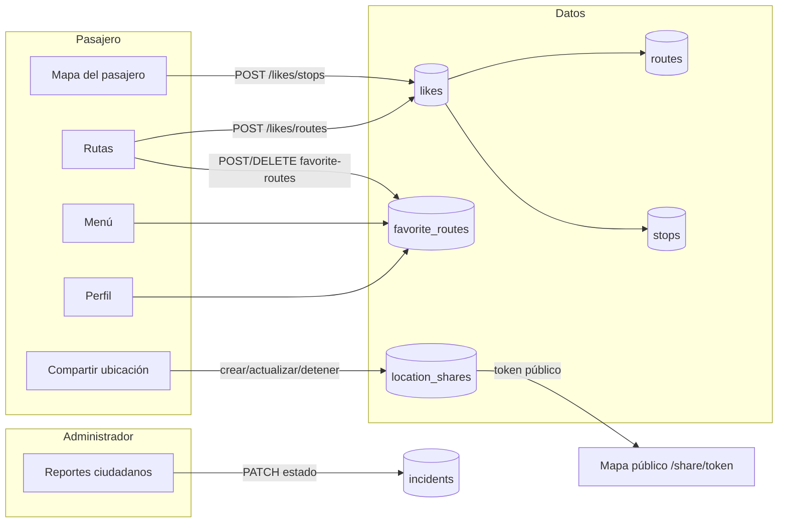
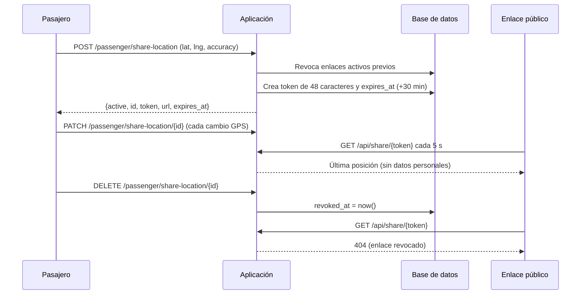

# Iteración 4 — Likes, rutas favoritas, ubicación compartida y reportes

La iteración 4 amplía la plataforma con funciones de interacción social, privacidad y gestión administrativa. Se trabajó con **TDD** (pruebas primero en rojo, implementación y suite completa en verde) sobre la rama `test`, con **bun** como gestor de paquetes y compilador de assets.

## Objetivos

| # | Objetivo | Resultado |
|---|----------|-----------|
| 1 | Me gusta públicos sobre rutas y paradas, separados de los favoritos personales. | `likes` polimórfico + endpoints de alternancia + contadores en rutas, menú y mapa. |
| 2 | Rutas favoritas para pasajeros. | Tabla `favorite_routes`, controlador dedicado y listas en menú, rutas y perfil. |
| 3 | Compartir la ubicación en vivo mediante un enlace temporal. | `location_shares` + página pública `/share/{token}` con polling cada 5 s. |
| 4 | Gestión administrativa de reportes ciudadanos. | `/admin/incidents` con filtros, búsqueda y transiciones de estado. |
| 5 | Perfil con métricas reales y listas de favoritos. | `ProfileController@edit` expone conteos y colecciones reales. |
| 6 | Restilizado glass completo. | Navegación, componentes Breeze, layouts y vistas heredadas al estilo mobile-first. |

## Arquitectura de las funciones sociales



## Me gusta polimórficos

### Modelo y tabla

| Elemento | Detalle |
|----------|---------|
| Modelo | `App\Models\Like` |
| Tabla | `likes` |
| Relación | `likeable()` (`morphTo`) hacia `Route` o `Stop` |
| Único | `(user_id, likeable_type, likeable_id)` |
| Entidades | `Route::likes()` y `Stop::likes()` (`morphMany`) |
| Estado personal | `Route::isLikedBy(User)` y `Stop::isLikedBy(User)` |

Los likes son **públicos**: el contador se muestra a cualquier visitante autenticado. Los favoritos, en cambio, son privados y personales.

### Endpoints

| Método | URI | Nombre | Respuesta JSON |
|--------|-----|--------|----------------|
| POST | `/likes/routes/{route}` | `likes.routes.toggle` | `{ "liked": true, "count": 12 }` |
| POST | `/likes/stops/{stop}` | `likes.stops.toggle` | `{ "liked": false, "count": 7 }` |

El controlador `LikeController` busca el like existente del usuario, lo elimina o lo crea, y devuelve el contador recalculado. Si la petición no espera JSON, redirige con un mensaje flash.

### Interfaz

| Vista | Comportamiento |
|-------|----------------|
| `passenger/routes` | Botón de corazón por ruta; el contador se actualiza sin recargar y el filtro **"Favoritas"** sigue funcionando. |
| `passenger/dashboard` | Cada parada del mapa tiene una acción de me gusta; el popup muestra el total. |
| `passenger/menu` | Las tarjetas de ruta muestran el contador público. |

## Rutas favoritas

| Elemento | Detalle |
|----------|---------|
| Modelo | `App\Models\FavoriteRoute` |
| Tabla | `favorite_routes` con único `(user_id, route_id)` |
| Relaciones | `User::favoriteRoutes()` (`belongsToMany`), `Route::favoritedByUsers()` |
| Controlador | `Passenger\FavoriteRouteController` |
| Middleware | `auth` + `passenger` |

| Método | URI | Nombre | Comportamiento |
|--------|-----|--------|----------------|
| POST | `/passenger/favorite-routes/{route}` | `passenger.favorite-routes.add` | Agrega; 400 si ya existía. |
| DELETE | `/passenger/favorite-routes/{route}` | `passenger.favorite-routes.remove` | Quita la ruta. |

Las rutas favoritas se listan en `passenger/menu`, se marcan en `passenger/routes` (incluido el filtro **"Favoritas"**) y se muestran en `profile/edit`. Son independientes de los me gusta: una ruta puede tener muchos likes y no estar en los favoritos de un usuario.

## Ubicación compartida

### Flujo



### Modelo y reglas

| Aspecto | Implementación |
|---------|----------------|
| Modelo | `App\Models\LocationShare` |
| Token | `Str::random(48)`, único en la tabla |
| Caducidad | `LocationShare::TTL_MINUTES = 30` |
| Revocación | Un enlace nuevo revoca el anterior del mismo usuario. |
| Propiedad | Solo el dueño puede actualizar o detener (`403` para otros). |
| Validación | Latitud −90..90, longitud −180..180, precisión entero 0..65535. |
| Privacidad | El payload público expone token, URL, coordenadas, precisión, estado y fechas; **nunca** nombre, correo ni ID del pasajero. |

### Endpoints

| Método | URI | Middleware | Descripción |
|--------|-----|------------|-------------|
| POST | `/passenger/share-location` | `auth`, `passenger` | Crea el enlace y revoca el anterior. |
| GET | `/passenger/share-location/current` | `auth`, `passenger` | Rehidrata la UI con el enlace activo. |
| PATCH | `/passenger/share-location/{share}` | `auth`, `passenger` | Actualiza la posición. |
| DELETE | `/passenger/share-location/{share}` | `auth`, `passenger` | Detiene la compartición. |
| GET | `/share/{token}` | público | Página HTML con mapa Leaflet. |
| GET | `/api/share/{token}` | público | JSON con la última posición. |

### Vista pública

`share/show.blade.php` no requiere sesión. Consulta `/api/share/{token}` cada 5 segundos, mueve un marcador y muestra un aviso cuando el enlace caduca o se revoca. La página no incluye ningún dato identificativo del pasajero.

## Reportes ciudadanos en administración

| Elemento | Detalle |
|----------|---------|
| Modelo | `App\Models\Incident` (categorías y estados existentes desde la iteración anterior) |
| Controlador | `Admin\IncidentManagementController` |
| Vistas | `admin/incidents/index.blade.php` |
| Migración | `2026_11_08_000004_add_resolved_at_to_incidents_table.php` |

| Método | URI | Nombre | Descripción |
|--------|-----|--------|-------------|
| GET | `/admin/incidents` | `admin.incidents.index` | Listado global con filtros `status`, `category` y búsqueda `q`. |
| PATCH | `/admin/incidents/{incident}` | `admin.incidents.update` | Cambia el estado y ajusta `resolved_at`. |

Estados y categorías:

| Campo | Valores |
|-------|---------|
| `status` | `pending`, `in_review`, `resolved` |
| `category` | `route`, `bus`, `service`, `driver`, `stop`, `other` |

Regla de `resolved_at`: se fija con la fecha actual al pasar a `resolved` (si aún no existía) y se limpia al reabrir el reporte (`pending` o `in_review`). Los reportes enviados por usuarios siguen creándose con estado `pending` forzado en el servidor.

La navegación de administración incorpora **"Incidencias"** (`admin.incidents.index`) y mantiene **"Emergencias"** para las alertas de conductores, que son un flujo distinto.

## Perfil enriquecido

`ProfileController@edit` ahora entrega métricas reales y listas de favoritos:

| Dato | Origen |
|------|--------|
| Rutas favoritas | `User::favoriteRoutes()` con conteo de likes |
| Paradas favoritas | `User::favoriteStops()` |
| Calificaciones emitidas | `User::ratingsGiven()` |
| Me gusta emitidos | `User::likes()` |
| Reportes enviados | `User::incidents()` |

`profile/edit.blade.php` muestra tarjetas de métricas, listas de rutas y paradas favoritas, y los formularios de actualización y baja de cuenta con estilo glass.

## Restilizado glass

Se completó el estilo *glass* mobile-first (referencia 375×667) en todo lo que quedaba fuera de la receta:

| Elemento | Cambio |
|----------|--------|
| `layouts/navigation.blade.php` | Envoltura sticky que reutiliza `<x-passenger-nav />`. |
| `components/passenger-nav.blade.php` | Nuevo enlace de incidencias, menú responsive en `lg`, conmutador de modo oscuro funcional y persistencia en `localStorage['darkMode']`. |
| Componentes Breeze | Botones, campos, etiquetas, errores, estados, dropdown, nav links y modal con paneles translúcidos. |
| `layouts/guest.blade.php` | Fondo con orbes difuminados y tarjeta glass. |
| `layouts/app.blade.php` | Fondo suave y encabezado translúcido. |
| `welcome.blade.php` | Landing glass con hero y accesos. |
| `dashboard.blade.php` | Tarjeta glass de respaldo. |
| `profile/partials/*` | Restilizados y traducidos al español (código muerto, pero coherente). |

## Pruebas

Se escribieron primero las pruebas de aceptación y luego la implementación.

| Archivo | Pruebas | Cobertura |
|---------|:-------:|-----------|
| `tests/Feature/Likes/LikeTest.php` | 8 | Alternancia, contador, unicidad y estado personal. |
| `tests/Feature/Passenger/FavoriteRouteTest.php` | 7 | Alta/baja, duplicados, rol y exposición en vistas. |
| `tests/Feature/Passenger/LocationShareTest.php` | 11 | Creación, token, caducidad, revocación, propiedad y endpoints públicos. |
| `tests/Feature/Admin/IncidentManagementTest.php` | 11 | Listado, filtros, búsqueda, transiciones y `resolved_at`. |

Resultado de la suite completa al cierre:

```text
134 pruebas / 503 aserciones en verde
```

| Comando | Resultado |
|---------|-----------|
| `php artisan test` | 134 pruebas, 503 aserciones, 0 fallos. |
| `bun run build` | Compilación correcta de CSS y JS con Vite. |

### Pruebas E2E y de carga

Los scripts se actualizaron, pero **no se ejecutaron en este entorno** porque no hay Chrome ni k6 instalados; están previstos para la rama `test`.

| Tipo | Archivo | Cobertura añadida |
|------|---------|-------------------|
| Selenium | `tests/selenium/test_passenger.py` | Me gusta en rutas, favoritos y panel de ubicación compartida. |
| Selenium | `tests/selenium/test_incident_admin.py` | Gestión de reportes ciudadanos desde administración. |
| Selenium | `tests/selenium/test_responsive.py` | Nuevas vistas incluidas en la matriz 375×667 y 1366×768. |
| k6 | `tests/load/ubicaditos-iteration4-load.js` | Lecturas de rutas, favoritos, incidencias y estado de compartición. |

Comandos previstos:

```bash
python3 -m pytest tests/selenium
k6 run tests/load/ubicaditos-iteration4-load.js -e K6_VUS=15
```

## Archivos principales

| Capa | Archivos |
|------|----------|
| Migraciones | `2026_11_08_000001_create_likes_table.php`, `...000002_create_favorite_routes_table.php`, `...000003_create_location_shares_table.php`, `...000004_add_resolved_at_to_incidents_table.php` |
| Modelos | `Like`, `FavoriteRoute`, `LocationShare`, `Incident` (actualizado), `User`, `Route`, `Stop` |
| Controladores | `LikeController`, `Passenger\FavoriteRouteController`, `LocationShareController`, `Admin\IncidentManagementController` |
| Rutas | `routes/web.php` (likes, favoritos, compartición y reportes) |
| Vistas | `passenger/dashboard`, `passenger/routes`, `passenger/menu`, `admin/incidents/index`, `share/show`, `profile/edit`, navegación y componentes |
| Pruebas | `tests/Feature/Likes`, `tests/Feature/Passenger/FavoriteRouteTest.php`, `tests/Feature/Passenger/LocationShareTest.php`, `tests/Feature/Admin/IncidentManagementTest.php` |
| Documentación | `docs/16-iteracion-4.md`, `docs/swagger.yaml`, secciones 04–12 y `_devlog.md` |

## Comandos útiles

```bash
# Migrar la base local con las nuevas tablas
php artisan migrate

# Ejecutar toda la suite
php artisan test

# Compilar assets con bun
bun run build

# Listar las rutas nuevas
php artisan route:list --name=likes
php artisan route:list --name=favorite-routes
php artisan route:list --name=share
php artisan route:list --name=incidents
```

## Decisiones y aprendizajes

| Decisión | Motivo |
|----------|--------|
| Likes polimórficos | Evita duplicar tablas y permite contadores homogéneos en rutas y paradas. |
| Favoritos en tabla propia | Los favoritos son privados y personales; los likes son públicos. Mezclarlos habría complicado permisos y métricas. |
| Enlace temporal con token aleatorio | Permite compartir sin exponer la cuenta ni el ID del pasajero, y caduca solo. |
| Revocar el enlace anterior | Evita dejar enlaces activos olvidados y reduce la superficie de exposición. |
| `resolved_at` en el modelo | Centraliza la transición de estado y evita fechas inconsistentes. |
| Reutilizar `<x-passenger-nav>` | Una sola navegación para los tres roles y un único lugar donde mantener enlaces y modo oscuro. |
