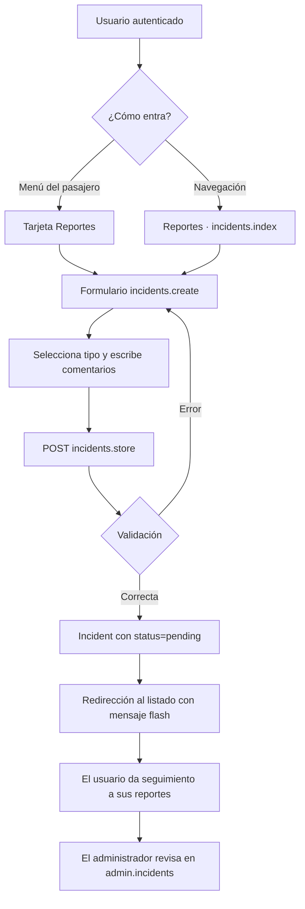
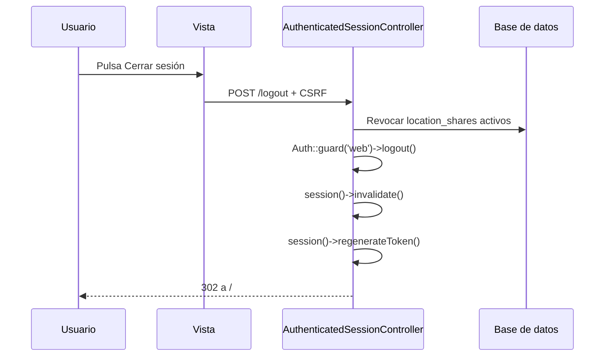

# Iteración 5 y 6 — Reportes de incidencias, rutas, perfil y sesión

Esta entrega cierra dos iteraciones que estaban planteadas pero no completamente verificadas: el **flujo de reportes de incidencias** (iteración 5) y la **consulta de rutas, la configuración del perfil y el cierre de sesión seguro** (iteración 6). El trabajo se hizo con **TDD** sobre la rama `test`: primero se escribieron pruebas que reprodujeran los huecos, después se implementó la corrección y finalmente se ejecutó la suite completa.

## Objetivos

| Iteración | Objetivo | Resultado |
|-----------|----------|-----------|
| 5 | Acceso al formulario de reportes. | Tarjeta **Reportes** en el menú del pasajero, enlace en la navegación y acceso directo a `/incidents/create`. |
| 5 | Selección de tipo y comentarios. | Selector con las seis categorías del modelo `Incident` y textarea de descripción con contador. |
| 5 | Registro y envío de incidencias. | `IncidentController@store` crea el reporte con estado `pending` y dueño tomado de la sesión. |
| 5 | Validación funcional del flujo. | Pruebas de acceso, validación, persistencia, aislamiento por usuario y protección contra campos manipulados. |
| 6 | Listado completo y rutas favoritas. | Listado de rutas activas con búsqueda, chips, favoritos y despliegue del recorrido completo de paradas. |
| 6 | Perfil personal y configuración. | Formulario con nombre, apellidos paterno y materno, teléfono, correo, contraseña y eliminación de cuenta. |
| 6 | Cierre de sesión seguro. | Logout por `POST` con CSRF, invalidación de sesión, regeneración de token y revocación de enlaces de ubicación activos. |
| 6 | Integración frontend-backend. | Formularios y acciones `fetch` alineados con las rutas, validaciones y respuestas reales del backend. |

## Iteración 5 — Reportes de incidencias

### Acceso al módulo

El módulo vive en tres rutas protegidas por `auth`:

| Método | URI | Nombre | Acción |
|--------|-----|--------|--------|
| GET | `/incidents` | `incidents.index` | Listado de reportes del usuario autenticado. |
| GET | `/incidents/create` | `incidents.create` | Formulario de captura. |
| POST | `/incidents` | `incidents.store` | Validación y registro del reporte. |

Se puede llegar al formulario desde la navegación por rol (enlace **Reportes**), desde el listado y desde la nueva tarjeta **Reportes** del menú del pasajero. La tarjeta muestra además cuántos reportes se han enviado y cuántos siguen pendientes.

### Captura del reporte

El formulario solicita dos datos:

| Campo | Nombre interno | Regla |
|-------|----------------|-------|
| Tipo de incidencia | `category` | Obligatorio; debe pertenecer a `route`, `bus`, `service`, `driver`, `stop` u `other`. |
| Comentarios | `description` | Obligatorio; texto de hasta 1000 caracteres (`Incident::MAX_DESCRIPTION_LENGTH`). |

Las categorías se traducen en la vista a etiquetas comprensibles: problemas con una ruta, con un autobús, con el servicio, con un conductor, con una parada u **Otro**.

### Reglas de seguridad y validación

| Regla | Implementación |
|-------|----------------|
| El dueño no se elige desde el formulario. | `store` usa `$request->user()->incidents()->create(...)`. |
| El estado inicial no se puede manipular. | El backend fuerza `status = pending`; los campos `status`, `user_id` y `resolved_at` no se validan desde la entrada. |
| Cada usuario ve solo sus reportes. | `index` consulta la relación `$request->user()->incidents()`. |
| El tipo debe existir en el catálogo. | Regla `Rule::in(array_keys(Incident::CATEGORIES))`. |
| Los comentarios son obligatorios y acotados. | `required`, `string`, `max:1000`; la vista conserva el valor con `old()` si falla la validación. |
| El flujo funciona para cualquier rol autenticado. | Las rutas usan `auth`; conductor y administrador también pueden abrir el formulario si lo necesitan. |

La administración de los reportes ciudadanos se mantiene separada en `/admin/incidents`, donde el administrador puede filtrar, buscar y mover el estado entre `pending`, `in_review` y `resolved`.

## Iteración 6 — Rutas, perfil y sesión

### Listado de rutas y favoritas

`GET /passenger/routes` entrega las rutas activas con sus paradas, autobuses, contador de me gusta y los identificadores de rutas favoritas del usuario. La vista ofrece:

| Función | Comportamiento |
|---------|----------------|
| Listado completo | Cada tarjeta muestra nombre, código, color, número de paradas y autobuses activos. |
| Recorrido completo | Las rutas con más de tres paradas incluyen un desplegable **Ver las N paradas** con todas las paradas en orden. |
| Búsqueda | Filtra por nombre o código en el cliente, sin recargar. |
| Chips | Filtros **Todas**, **Con autobuses activos** y **Favoritas**. |
| Me gusta | Botón que llama a `POST /likes/routes/{route}` y actualiza el contador visible. |
| Favorito | Botón que llama a `POST` o `DELETE /passenger/favorite-routes/{route}` y actualiza el estado sin recargar. |
| Mapa | Enlace al mapa del pasajero con la ruta preseleccionada. |

Las rutas favoritas también aparecen en el menú del pasajero y en el perfil. Los favoritos son personales; los **me gusta** son un contador público y se gestionan por separado.

### Perfil personal y configuración

El formulario `GET /profile` se alineó con el esquema real de `users` y con `ProfileUpdateRequest`. Antes la vista solo enviaba nombre, apellido paterno y correo, mientras el backend exigía también el apellido materno; eso hacía que guardar el perfil fallara desde la interfaz. Ahora el formulario incluye:

| Campo | Nombre interno | Validación |
|-------|----------------|------------|
| Nombre | `first_name` | Obligatorio, máximo 35, solo letras y espacios. |
| Apellido paterno | `last_name` | Obligatorio, máximo 35, solo letras y espacios. |
| Apellido materno | `maternal_last_name` | Obligatorio, máximo 35, solo letras y espacios. |
| Teléfono | `phone` | Opcional; si se envía, exactamente 10 dígitos. |
| Correo | `email` | Obligatorio, formato válido, minúsculas y único. |
| Contraseña | `current_password`, `password`, `password_confirmation` | Sección independiente con `PasswordController`. |

El perfil conserva las métricas reales de la iteración 4 (paradas y rutas favoritas, calificaciones emitidas, me gusta y reportes), las listas de favoritos, el cambio de contraseña, los botones para mostrar u ocultar contraseñas y la eliminación de cuenta con confirmación.

### Cierre de sesión seguro

El cierre de sesión no es un simple enlace: es un formulario `POST /logout` con token CSRF. El controlador realiza cuatro acciones en orden:

1. Revoca los enlaces temporales de ubicación activos del usuario (`revoked_at = now()`).
2. Cierra la sesión del guard `web`.
3. Invalida los datos de la sesión.
4. Regenera el token CSRF.

La revocación de enlaces es importante para la privacidad: si un pasajero estaba compartiendo su ubicación y cierra sesión, el enlace público deja de mostrar su posición. El perfil muestra una nota que explica este comportamiento.

### Integración frontend-backend

| Acción de la interfaz | Endpoint real | Respuesta esperada |
|-----------------------|---------------|--------------------|
| Enviar un reporte | `POST /incidents` | Redirección al listado con mensaje flash. |
| Alternar me gusta de ruta | `POST /likes/routes/{route}` | JSON `{liked, count}`. |
| Alternar me gusta de parada | `POST /likes/stops/{stop}` | JSON `{liked, count}`. |
| Guardar ruta favorita | `POST /passenger/favorite-routes/{route}` | JSON o redirección. |
| Quitar ruta favorita | `DELETE /passenger/favorite-routes/{route}` | JSON o redirección. |
| Actualizar perfil | `PATCH /profile` | Redirección con `status`. |
| Cambiar contraseña | `PUT /password` | Redirección con `status`. |
| Cerrar sesión | `POST /logout` | Redirección, sesión invalidada y enlaces revocados. |

Los formularios usan `@csrf` y `@method` cuando corresponde; las acciones `fetch` envían `X-CSRF-TOKEN` y detectan `request()->expectsJson()` en el controlador para responder en JSON o con redirección.

## Pruebas añadidas o reforzadas

| Archivo | Qué verifica |
|---------|--------------|
| `tests/Feature/Incidents/IncidentTest.php` | Acceso desde el menú, disponibilidad para pasajero/conductor/administrador, validaciones, persistencia, aislamiento por usuario y campos no manipulables. |
| `tests/Feature/Passenger/RouteListingTest.php` | Rutas activas, recorrido completo de paradas, exclusión de rutas inactivas y marcado de favoritas. |
| `tests/Feature/ProfileTest.php` | Campos visibles y precargados, actualización de apellido materno y teléfono, validación de teléfono y obligatoriedad del apellido materno. |
| `tests/Feature/Auth/AuthenticationTest.php` | Logout con limpieza de sesión y revocación de enlaces de ubicación activos. |

## Verificación

| Comando | Resultado |
|---------|-----------|
| `php artisan test` | **143 pruebas / 554 aserciones en verde**. |
| `php artisan view:cache` | Todas las plantillas Blade compilan. |
| `bun run build` | Assets compilados correctamente con Vite. |

## Archivos principales modificados

| Archivo | Cambio |
|---------|--------|
| `resources/views/passenger/menu.blade.php` | Tarjeta de acceso directo a reportes y conteo de pendientes. |
| `resources/views/passenger/routes.blade.php` | Desplegable con el recorrido completo de paradas. |
| `resources/views/profile/edit.blade.php` | Apellido materno, teléfono, botones de visibilidad de contraseña y nota de seguridad. |
| `app/Http/Requests/ProfileUpdateRequest.php` | Regla de teléfono y mensajes en español. |
| `app/Http/Controllers/Auth/AuthenticatedSessionController.php` | Revocación de enlaces de ubicación al cerrar sesión. |
| `app/Http/Controllers/Passenger/PassengerController.php` | Conteos de reportes para el menú del pasajero. |
| `tests/Feature/Incidents/IncidentTest.php` | Acceso al módulo desde menú y por rol. |
| `tests/Feature/Passenger/RouteListingTest.php` | Cobertura del listado completo de rutas. |
| `tests/Feature/ProfileTest.php` | Cobertura del formulario completo y del teléfono. |
| `tests/Feature/Auth/AuthenticationTest.php` | Cobertura del cierre de sesión seguro. |

## Pendientes y siguientes pasos

- Ejecutar las pruebas E2E de Selenium en un entorno con Chrome y las pruebas de carga con k6; en este entorno no están disponibles.
- Regenerar los trazados de las rutas con `php artisan routes:generate-paths --force` cuando haya conectividad para consultar OSRM.
- Mantener la documentación Swagger sincronizada con cualquier nuevo endpoint de incidencias o perfil.
