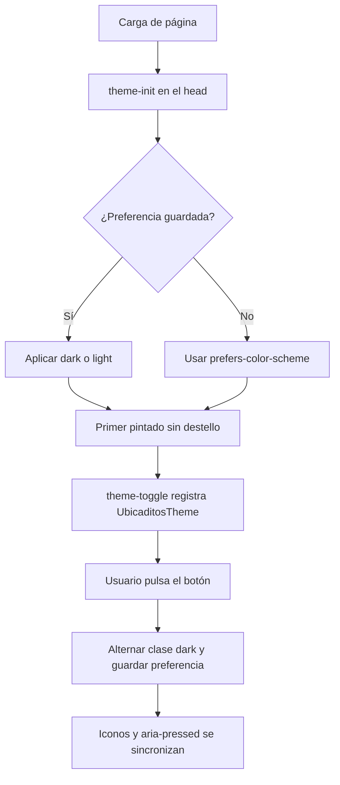
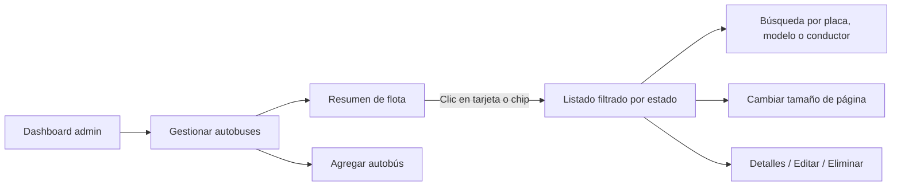

# Iteración 7 — Modo oscuro y administración

Esta iteración activa el **modo oscuro** en toda la aplicación, unifica el conmutador de tema en un solo componente reutilizable y refuerza el **panel administrativo** con contadores de flota y reportes, además de un listado de autobuses con resumen, filtros por estado y gestión inicial. El trabajo se realizó con **TDD** sobre la rama `test`: primero se escribieron las pruebas del listado, los filtros, los contadores y el tema; después se implementó y se ejecutó la suite completa.

## Objetivos

| Objetivo | Resultado |
|----------|-----------|
| Activar el modo oscuro. | Tema persistido en `localStorage['ubicaditos-theme']`, con respeto a la preferencia del sistema y compatibilidad con la clave anterior `darkMode`. |
| Aplicación consistente en componentes. | Variantes `dark:` en layouts, navegación, autenticación, mapas de pasajero/conductor/administrador, menú, rutas, autobuses, reportes, perfil, estadísticas y administración. |
| Dashboard administrativo. | Nuevos contadores de flota (mantenimiento, emergencia, inactivos) y de reportes (incidencias y emergencias pendientes) con acceso directo a cada listado filtrado. |
| Listados iniciales de autobuses y gestión. | Resumen de flota en cuatro tarjetas, chips de filtro por estado, búsqueda por placa/modelo/conductor, paginación validada y acciones de detalle, edición y eliminación. |
| Calidad. | 23 pruebas nuevas y suite completa en verde. |

## Modo oscuro

### Inicialización sin destello

El parcial `resources/views/partials/theme-init.blade.php` se incluye en el `<head>` de los layouts `app`, `guest` y `passenger-layout`. Se ejecuta antes del primer pintado y decide el tema en este orden:

1. `localStorage['ubicaditos-theme']` (`dark` o `light`).
2. `localStorage['darkMode']` (`true` o `false`) para conservar la preferencia de versiones anteriores.
3. `prefers-color-scheme: dark` del sistema operativo cuando no hay preferencia guardada.

Después aplica la clase `dark` al elemento `<html>` y ajusta `color-scheme`, lo que evita el destello de modo claro al recargar.

### Conmutador reutilizable

El componente `resources/views/components/theme-toggle.blade.php` reemplaza el antiguo botón incrustado en la navegación. Expone:

| Elemento | Comportamiento |
|----------|----------------|
| `data-theme-toggle` | Botón accesible con `aria-pressed` y `title` que cambia entre **Cambiar a modo claro** y **Cambiar a modo oscuro**. |
| Iconos luna/sol | La luna se muestra en modo claro y el sol en modo oscuro mediante `dark:hidden` y `dark:block`. |
| `window.UbicaditosTheme` | API con `current()`, `set(theme)` y `toggle()` para que cualquier vista pueda leer o cambiar el tema. |
| Delegación de clics | Un único listener atiende todos los botones `[data-theme-toggle]`, por lo que puede haber varios en la misma página. |
| Persistencia | Guarda `ubicaditos-theme` y, por compatibilidad, `darkMode`. |
| Cambio del sistema | Si el usuario no ha elegido manualmente, escucha `prefers-color-scheme` y actualiza el tema en caliente. |

El componente se usa en `components/passenger-nav.blade.php` (visible para todos los roles autenticados) y en `layouts/guest.blade.php` (pantallas de autenticación). Al ser un componente compartido, cualquier cambio futuro de estilo o comportamiento se hace en un solo archivo.

### Cobertura visual

Las variantes oscuras se aplicaron a:

| Área | Vistas |
|------|--------|
| Shell y navegación | `layouts/app`, `layouts/guest`, `components/passenger-layout`, `components/passenger-nav`. |
| Autenticación | `auth/login`. |
| Pasajero | `passenger/menu`, `passenger/routes`, `passenger/buses`, `share/show`. |
| Conductor | `driver/dashboard`, `driver/statistics`. |
| Reportes | `incidents/index`, `incidents/create`. |
| Administración | `admin/dashboard`, `admin/buses/index`. |

Los mapas Leaflet se integran con el tema desde `resources/css/app.css`: fondo oscuro para los contenedores (`#admin-map`, `#map`, `#passenger-map`, `#driver-map`, `#share-map`), inversión de la capa de teselas, controles de zoom/atribución oscuros y popups de paradas con superficies, chips y acciones adaptadas. El CSS global también define `color-scheme` y una transición suave de color de fondo.

## Panel administrativo

### Dashboard

`AdminController@index` ahora entrega los contadores:

| Clave | Significado |
|-------|-------------|
| `maintenance_buses` | Unidades en mantenimiento. |
| `emergency_buses` | Unidades en estado de emergencia. |
| `inactive_buses` | Unidades inactivas. |
| `pending_incidents` | Reportes ciudadanos en estado `pending`. |
| `pending_emergencies` | Emergencias de conductores sin resolver. |

La vista `admin/dashboard` incorpora la tarjeta **Estado de la flota y reportes** con cinco accesos directos. Cada tarjeta enlaza al listado correspondiente ya filtrado: `admin.buses.index?status=maintenance`, `?status=emergency`, `?status=inactive`, `admin.incidents.index?status=pending` y `admin.emergencies`.

### Listado de autobuses

`BusController@index` valida y normaliza la entrada:

| Parámetro | Regla |
|-----------|-------|
| `search` | Texto libre; busca en placa, modelo y nombre/apellidos del conductor. |
| `status` | Solo `active`, `inactive`, `maintenance` o `emergency`; cualquier otro valor se ignora. |
| `per_page` | Solo `10`, `15`, `20` o `50`; por defecto `15`. |

La consulta usa `withQueryString()` para conservar los filtros al paginar. Además calcula `$summary` con el total y el conteo por estado.

La vista `admin/buses/index` presenta:

| Elemento | Comportamiento |
|----------|----------------|
| Cuatro tarjetas de resumen | Flota total, en servicio, mantenimiento y emergencias; son enlaces que aplican el filtro. |
| Chips de estado | **Todos**, **En servicio**, **Mantenimiento**, **Emergencia** e **Inactivos**, con conteo y estado activo resaltado. |
| Búsqueda | Formulario que conserva el filtro de estado y muestra **Limpiar** cuando hay filtros activos. |
| Paginación | Selector **Mostrar** que conserva búsqueda y estado. |
| Tabla | Placa, modelo, capacidad, conductor, rutas, insignia de estado y acciones **Detalles**, **Editar** y **Eliminar**. |
| Estado vacío | Distingue entre flota vacía y filtros sin resultados, con la acción adecuada en cada caso. |
| Alta | Botón **Agregar Autobús** siempre visible en el encabezado. |

El CRUD mantiene las validaciones existentes: placa de 6 caracteres con formato `ABC123`, modelo del catálogo, capacidad entre 30 y 50 y estado limitado a `active`, `inactive` o `maintenance` (la emergencia se reserva al flujo de reportes del conductor).

## Pruebas añadidas

| Archivo | Qué verifica |
|---------|--------------|
| `tests/Feature/Admin/BusManagementTest.php` | Acceso por rol, listado con resumen, filtro por estado, estado inválido ignorado, búsqueda por placa/modelo/conductor, paginación validada, alta con rutas, rechazo de placa inválida y estado `emergency` en el CRUD, actualización, eliminación y protección de escrituras. |
| `tests/Feature/Admin/AdminDashboardTest.php` | Acceso por rol, contadores de flota y reportes, render de la tarjeta de estado y estado vacío del dashboard. |
| `tests/Feature/ThemeTest.php` | Inicialización del tema y toggle en login, layout del pasajero y layout administrativo. |
| `tests/Feature/Admin/AdminReportsTest.php` | Vista única de reportes y estadísticas: acceso por rol, redirección de `admin.statistics`, datos de viajes, autobuses, conductores y accesos de exportación. |

## Verificación

| Comando | Resultado |
|---------|-----------|
| `php artisan test` | **166 pruebas / 655 aserciones en verde**. |
| `php artisan view:cache` | Todas las plantillas Blade compilan. |
| `bun run build` | Assets compilados correctamente con Vite. |

## Archivos principales

| Archivo | Cambio |
|---------|--------|
| `resources/views/partials/theme-init.blade.php` | **Nuevo.** Inicialización del tema antes del primer pintado. |
| `resources/views/components/theme-toggle.blade.php` | **Nuevo.** Botón, iconos, persistencia y API `UbicaditosTheme`. |
| `resources/views/layouts/app.blade.php` | Inclusión del inicializador y fondo oscuro. |
| `resources/views/layouts/guest.blade.php` | Inclusión del inicializador y toggle en autenticación. |
| `resources/views/components/passenger-layout.blade.php` | Inclusión del inicializador y fondo oscuro. |
| `resources/views/components/passenger-nav.blade.php` | Sustitución del toggle anterior por `<x-theme-toggle />` y enlace único **Reportes** en la navegación administrativa. |
| `resources/css/app.css` | Reglas globales de tema, mapas Leaflet y popups oscuros; fondos oscuros de las vistas administrativas. |
| `app/Http/Controllers/Admin/AdminController.php` | Contadores de flota y reportes pendientes; se retiró `statistics()` al unificar la vista. |
| `app/Http/Controllers/Admin/ReportController.php` | Datos de la vista única: viajes por día, autobuses, conductores, rutas y emergencias por tipo. |
| `app/Http/Controllers/Admin/BusController.php` | Filtro por estado, paginación validada y resumen de flota. |
| `resources/views/admin/dashboard.blade.php` | Tarjeta **Estado de la flota y reportes**; fondo y teselas del mapa adaptados al modo oscuro. |
| `resources/views/admin/buses/index.blade.php` | Resumen, chips de filtro, búsqueda y paginación con filtros conservados. |
| `resources/views/admin/reports.blade.php` | Vista única **Reportes y Estadísticas**, con exportaciones, rutas más utilizadas y emergencias por tipo. |
| `resources/views/admin/statistics.blade.php` | **Eliminada.** `/admin/statistics` redirige a `/admin/reports`. |
| `routes/web.php` | Redirección de `admin.statistics` a `admin.reports`. |
| `tests/Feature/Admin/BusManagementTest.php` | **Nuevo.** Cobertura del listado y CRUD de autobuses. |
| `tests/Feature/Admin/AdminDashboardTest.php` | **Nuevo.** Cobertura de contadores del dashboard. |
| `tests/Feature/ThemeTest.php` | **Nuevo.** Cobertura del tema compartido. |
| `tests/Feature/Admin/AdminReportsTest.php` | **Nuevo.** Cobertura de la vista única de reportes y estadísticas. |

## Corrección posterior — fondos oscuros y vista única

Al revisar el panel con el tema oscuro se detectó que los degradados locales de varias vistas administrativas seguían usando la paleta clara, por lo que el fondo se veía blanco. Se añadieron reglas globales `.dark .<page>` en `resources/css/app.css` para todas las superficies administrativas y se ajustó el mapa del dashboard para que sus teselas y su fondo también se oscurezcan.

Además, `admin/reports` y `admin/statistics` se unificaron en una sola vista **Reportes y Estadísticas**. La ruta histórica `/admin/statistics` redirige a `/admin/reports`, la navegación administrativa muestra un único enlace y la vista incorpora las secciones de rutas más utilizadas y emergencias por tipo, además de los botones de exportación PDF/CSV. Se añadió `AdminReportsTest` para cubrir el acceso, la redirección y los datos de la vista unificada.

## Pendientes y siguientes pasos

- Ejecutar las pruebas E2E de Selenium y las de carga con k6 en un entorno con Chrome y k6.
- Añadir cobertura dedicada al CRUD de rutas y paradas, que sigue siendo el hueco principal de administración.
- Revisar el contraste de los mapas oscuros en dispositivos de gama baja y con `prefers-reduced-motion`.
- Sincronizar Swagger si en el futuro se exponen los filtros del listado administrativo como API.
